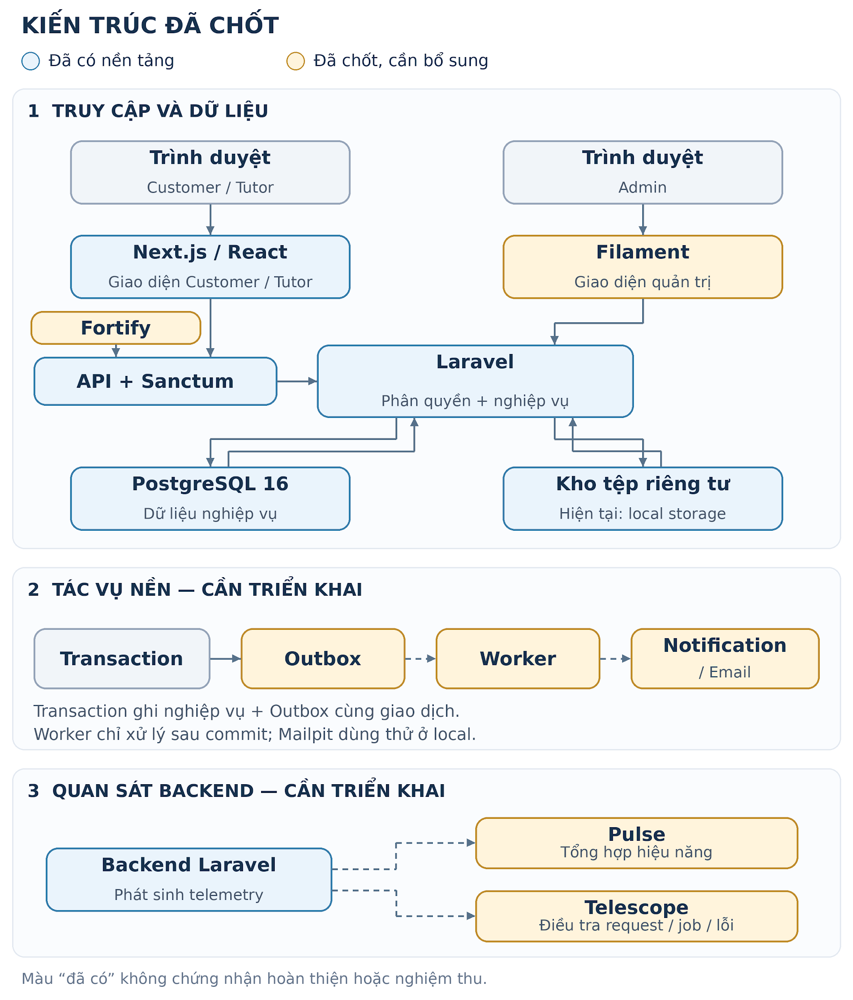

# System architecture & technology stack

**Trạng thái: ĐÃ CHỐT KIẾN TRÚC · 19/10/2026**

Stack: Next.js \+ Laravel \+ Fortify/Sanctum \+ PostgreSQL; Filament; Pulse/Telescope. Package bổ sung chưa được cài trong phạm vi tài liệu.

# 1\. Phạm vi và cách đọc

TutorLink là nền tảng dịch vụ 1–1 đa lĩnh vực: người dùng khám phá Tutor/huấn luyện viên đã duyệt, trao đổi qua chat, thống nhất Program bằng Invitation và phối hợp công việc trong Workspace. MVP ưu tiên web tiếng Việt, sáu mục Workspace, Review, Report và bảo vệ dữ liệu riêng tư; không gồm thanh toán trực tuyến, giữ chỗ khung giờ, video tích hợp hay Program nhóm. \[P1\]

Quy ước: Đã có \= thấy trong mã/cấu hình; Đã chốt, cần bổ sung \= công nghệ đích đã được lựa chọn nhưng chưa triển khai; Còn mở \= thông số triển khai hoặc nghiệp vụ chưa được quyết định. Chốt stack không đồng nghĩa container đang chạy, migration đã áp dụng hoặc chức năng đã nghiệm thu.

Căn cứ hiện trạng: checkout tại /home/dunggiait/Developer/WebDesign/EM4/TutorLink, HEAD 6f2f897 cùng working tree đọc ngày 19/10/2026; docker-compose.yml, backend/Dockerfile, composer.json/lock, package.json, routes, cấu hình và controller liên quan. Yêu cầu nghiệp vụ lấy từ Docs; ghi chú implementation cũ trong Docs không được coi là bằng chứng runtime mới. Không thay cấu hình, cài package hoặc chạy migration trong phạm vi tài liệu này.

# 2\. Hiện trạng được xác minh

| Thành phần đã khai báo | Phiên bản/bằng chứng | Vai trò hiện tại |
| :---- | :---- | :---- |
| Backend Laravel / PHP | Laravel ^13.17 → lock v13.35.0; php:8.3-cli; Composer 2 | API và nghiệp vụ; Dockerfile cài pdo\_pgsql; host :8000 |
| PostgreSQL | postgres:16-alpine; db:5432; host :5433 | DB nghiệp vụ; volume postgres\_data; healthcheck |
| Frontend riêng | node:22-bookworm-slim; Next 16.3.8; React 19.2.8 | Giao diện web hiện tại; Next dev trên :3000 |
| Sanctum | ^4.0 → lock v4.3.3; statefulApi; auth:sanctum | Xác thực API bằng phiên cookie đã thấy trong code |
| Asset Laravel | Vite ^8; Tailwind ^4; laravel-vite-plugin ^3.1 | Tooling khai báo; chưa có backend npm lock/build trong Compose |
| Tệp riêng tư | Storage local; backend\_storage | Bytes tệp trong storage/app/private; metadata ở DB |
| Công cụ local | pgAdmin 9.17; Mailpit latest | pgAdmin 127.0.0.1:5050; Mailpit UI :8025, SMTP :1025 |

Docker Compose hiện là môi trường phát triển: backend chạy Artisan serve; frontend chạy npm ci và Next dev. Các volume postgres\_data và backend\_storage giữ DB/tệp qua vòng đời container; volume không thay thế backup. Không thấy service Redis, Reverb, object storage, queue worker, scheduler, reverse proxy/TLS hoặc các công cụ giám sát được yêu cầu.

Khác biệt cần giữ rõ: backend/.env.docker đặt SESSION\_DRIVER=file, CACHE\_STORE=file, QUEUE\_CONNECTION=database; .env.example và mặc định config lại dùng database cho session/cache. Vì Compose nạp .env.docker, không được mô tả môi trường Docker hiện tại là đã lưu session/cache trong PostgreSQL. Chưa kiểm tra cấu hình runtime hiệu lực.

Đã thấy API cho xác thực, /me, catalog, public Listing/Tutor, owner Listing/availability, hồ sơ Tutor, tệp và một số quyết định Admin. routes/web.php chỉ trả welcome view. Không thấy routes nghiệp vụ cho chat, Program/Invitation, Workspace/Session, Task/Progress, Fee/Announcement/Notification hoặc Review/Report trong file API đã đọc. Migration hoặc OpenAPI có mô tả chúng không chứng minh triển khai hoàn chỉnh. \[A1\]

# 3\. Kiến trúc đã chốt

Kiến trúc đã chốt: Next.js/React cho Customer/Tutor; Laravel là backend API theo các module nghiệp vụ; Fortify cung cấp các luồng Auth chuẩn và Sanctum xác thực API bằng session cookie; PostgreSQL lưu dữ liệu. Filament là panel Admin trong Laravel. Pulse/Telescope hỗ trợ theo dõi backend. Quy mô và hiệu năng tham chiếu giữ theo Product/NFR, cần kiểm thử trước khi kết luận đáp ứng. \[P1, N1, T1, T2\]

Sơ đồ thể hiện kiến trúc đích đã chốt. Next.js, Laravel/Sanctum và PostgreSQL đã có nền tảng; Fortify, Filament, Pulse/Telescope và Outbox/worker cần triển khai. Màu sắc thể hiện hiện trạng, không phải mức phê duyệt. Mailpit chỉ dùng cho email thử ở local.

## 3.1. Phân lớp và phối hợp

* Lớp giao diện: Next.js/React phục vụ Customer/Tutor, gọi Laravel REST API cho xác thực và dữ liệu nghiệp vụ; chat dùng polling/resync theo contract. Filament cung cấp form, bảng và action Admin trong Laravel. Các lớp giao diện không tự quyết định quyền truy cập dữ liệu.  
* Lớp HTTP: Fortify cung cấp endpoint/luồng Auth chuẩn; API controller, Form Request, middleware và API Resource phục vụ nghiệp vụ cho Next.js. Filament xử lý request quản trị trong Laravel. Tích hợp Fortify cần giữ hoặc đồng bộ có kiểm soát contract /api/v1/auth hiện có, tránh hai bộ endpoint Auth cùng hoạt động.  
* Lớp nghiệp vụ: Action/Service và Policy/Gate dùng chung giữa API và Filament. Các thao tác như duyệt Tutor hoặc accept Invitation kiểm quyền, transition, transaction và audit tại Laravel. Hiện phần lớn xử lý nằm trong controller; tách lớp là công việc chuyển giao để tránh lặp quy tắc ở panel và API.  
* Lớp dữ liệu: Eloquent và migration quản lý schema PostgreSQL; foreign key, unique constraint, transaction, row lock và version bảo vệ tính nhất quán. Worker dùng cùng mã nghiệp vụ và chỉ xử lý dữ liệu đã commit.

## 3.2. Phối hợp Next.js, Laravel và Filament

Giữ Next.js/React cho Customer/Tutor và các màn hình xác thực. Laravel Fortify đảm nhiệm các luồng Auth chuẩn, Sanctum nhận diện phiên API; Filament phục vụ Admin trong cùng backend. Không chuyển frontend sang Blade/Vue và không triển khai Breeze Blade trong phạm vi chuyển giao này.

Tái sử dụng tài khoản, session guard và Sanctum hiện có. Fortify cần tích hợp các trường full\_name/password\_hash, role, tuổi, trạng thái tài khoản và URL email của TutorLink. Phân quyền owner/member/assignment vẫn do backend thực thi. Domain, cookie/CORS và request Next.js phía server phải được kiểm thử; dùng chung User không tự bảo đảm đăng nhập một lần giữa Next.js và Filament.

# 4\. Ranh giới các module nghiệp vụ

M01–M10 dưới đây là ranh giới logic trong cùng ứng dụng và cùng DB, không phải mười service độc lập. Trạng thái hoàn thiện từng API/UI cần đối chiếu backlog và bằng chứng nghiệm thu. \[M1\]

* M01 — Identity & Access: dùng Fortify cho đăng ký/đăng nhập, email verification và reset password; Sanctum xác thực API bằng phiên cookie. Customer/Tutor/Admin, tuổi, trạng thái tài khoản và quyền truy cập là nghiệp vụ riêng cần tích hợp. Guest không phải role; Admin tạo nội bộ. Customer từ đủ 15 tuổi, Tutor từ đủ 18 tuổi là yêu cầu sản phẩm, chưa coi validation hiện có đã đồng bộ.  
* M02 — Tutor Profile & Approval: hồ sơ, giấy tờ xác minh, gửi duyệt và quyết định Admin. Phân biệt trạng thái hồ sơ với trạng thái tài khoản; restore hồ sơ không tự mở account còn suspended. Quyết định cần permission, assignment tương ứng và audit.  
* M03 — Catalog & Marketplace: Category → Subcategory → Specialization, Listing, tìm kiếm và availability tham khảo. Public Listing cần active, Tutor account active, email verified, profile approved và chuỗi catalog active. Availability không giữ chỗ và giá Listing chỉ tham khảo.  
* M04 — Messaging: một Conversation cho cặp Customer–Tutor; Listing chỉ là ngữ cảnh. Tin nhắn lưu bền qua REST, cursor ổn định và polling/resync; retry dùng client\_message\_id. Reverb là lựa chọn sau phần lõi.  
* M05 — Program & Invitation: thỏa thuận riêng, snapshot lời mời bất biến, hạn 72 giờ. Đúng Customer đích accept thì Invitation accepted, membership và Program active phải được ghi nguyên tử, không trùng khi retry.  
* M06 — Session & Workspace: sáu mục Tổng quan, Buổi học, Nhiệm vụ, Tiến độ, Thông báo, Khoản phí. program\_sessions lưu lịch; lesson\_sessions lưu kết quả thực hiện 0..1 khi Tutor xác nhận hoàn tất, không suy buổi học đã diễn ra từ giờ dự kiến.  
* M07 — Task & Progress: giao nhiệm vụ, Submission có version, feedback đúng phiên bản và ghi tiến độ. Stale version trả conflict; không tự hoàn thành Task khi hoàn tất Program.  
* M08 — Fee, Announcement & Notification: phí do Tutor nhập tay theo Program/tháng; VND số nguyên không âm. FeeRecordStatus tách TutorPaymentMark, không xác nhận thanh toán thật. Announcement theo quyền Program; notification in-app theo người nhận, phát sinh sau commit.  
* M09 — Review, Report & Audit: Customer member được Review một lần sau Program completed; tiếp nhận/xử lý Report theo permission và scope. Audit nghiệp vụ là bản ghi riêng, cần bất biến và gắn transaction của hành động.  
* M10 — Files: metadata và liên kết tài nguyên, upload/complete/download theo owner, purpose và quyền tài nguyên. Giấy tờ, chat và bài nộp là riêng tư. Kho tệp dùng chung không cấp quyền đọc chung; clean hiện chỉ phản ánh kiểm metadata/checksum trong code, chưa chứng minh quét mã độc.

# 5\. Các luồng phối hợp quan trọng

## 5.1. Xác thực web, API và Admin

Next.js hiển thị form xác thực; Laravel Fortify cung cấp các luồng đăng nhập, đăng ký, đăng xuất, quên/reset mật khẩu và xác minh email khi được bật. Sanctum nhận diện phiên người dùng khi gọi API. Fortify/Sanctum là package chính thức của Laravel; nhóm vẫn chịu trách nhiệm cấu hình, tích hợp, kiểm thử và nghiệp vụ riêng. Chưa cài Fortify trong checkout được rà soát. \[T1, T2\]

Client trình duyệt khởi tạo CSRF qua /sanctum/csrf-cookie, gửi cookie phiên và X-XSRF-TOKEN cho mutation theo luồng xác thực SPA. Fortify dùng web guard phối hợp Sanctum; giao diện Next.js tiếp tục được sử dụng. PAT là credential riêng cho CLI/server-to-server, được quản lý bằng session cookie + CSRF; không dùng PAT làm cơ chế đăng nhập SPA hoặc lưu trong localStorage. \[P2, T1, T2\]

Filament là panel nội bộ dùng cùng nguồn User của Laravel; chỉ Admin active có quyền mới được truy cập. Mỗi resource/action/query và tải bằng chứng phải kiểm permission cùng assignment hiện tại. Quyền vào panel không cấp quyền đọc mọi dữ liệu. API Admin hiện có chưa chứng minh đáp ứng đầy đủ assignment scope; panel dùng cùng nghiệp vụ/Policy, không sao chép quy tắc riêng.

## 5.2. Duyệt Tutor, công khai Listing và accept Invitation

Tutor gửi hồ sơ và tệp xác minh → Admin được giao xử lý đưa ra quyết định → server tính eligibility/public visibility → Customer khám phá và trao đổi → Tutor gửi Invitation có snapshot → Customer đích chấp nhận. Public search, detail và profile phải dùng cùng điều kiện hiển thị.

Accept phải kiểm lại actor, hạn lời mời, trạng thái Program, Customer và eligibility của Tutor; khóa và kiểm version phù hợp rồi ghi accepted \+ member \+ active \+ audit/outbox trong cùng transaction. Đình chỉ đồng thời phải dùng giao thức khóa/isolation nhất quán; ADR-09 trong nguồn vẫn là nháp, chưa được xem là bài toán concurrency đã giải quyết. Retry vẫn kiểm quyền và không tạo side effect lần hai. \[D1, A1\]

## 5.3. Workspace, tác vụ nền và tệp

Owner/member đọc Workspace theo scope. Program paused chặn tạo Session/Task/Fee mới; Tutor vẫn được hoàn tất/hủy Session đã có theo xác nhận 18/10/2026, đồng thời được tạo, sửa Draft và publish Announcement theo BR-10 đã chốt ngày 20/10/2026. Sửa lịch Session khi paused còn cần quyết định. Program completed/cancelled chỉ đọc, ngoại trừ Review hợp lệ sau completed. \[D1\]

Thiết kế đích lưu Outbox Event cùng transaction nghiệp vụ; worker xử lý dữ liệu đã commit để tạo notification không trùng, scheduler xử lý hết hạn Invitation và công việc định kỳ. Database queue tái sử dụng PostgreSQL. Outbox không đồng nhất với bảng jobs. Chưa thấy Outbox, worker/scheduler service trong Compose hiện tại; cần triển khai và kiểm thử cùng các luồng nghiệp vụ sử dụng chúng. \[N2\]

Upload đi qua Laravel → lưu bytes vào local private storage → lưu metadata DB → complete kiểm tệp → gắn vào tài nguyên sau khi kiểm quyền. Download kiểm owner/member/assignment rồi stream hoặc cấp URL ngắn hạn nếu sau này dùng object storage. DB và filesystem không cùng transaction nên cần đối soát tệp mồ côi/thất lạc. S3 chỉ có cấu hình mẫu và được nhắc trong thiết kế dữ liệu; code hiện ghi local, chưa có căn cứ nói S3/MinIO đã triển khai.

# 6\. Vai trò và tính tương thích của công nghệ bổ sung

Đối chiếu ngày 19/10/2026 với PHP 8.3, Laravel khóa v13.35.0, Sanctum v4.3.3 và PostgreSQL 16\. Các công nghệ bổ sung dưới đây đã được chọn cho kiến trúc đích; phiên bản là mốc tham chiếu đã kiểm tra, không phải package đã cài. Chưa chạy Composer resolver, kiểm platform requirements, build hoặc test tích hợp; cần xác minh toàn bộ dependency trước triển khai.

| Công nghệ / trạng thái | Điều kiện đã kiểm tra | Kết luận và phần cần làm |
| :---- | :---- | :---- |
| Fortify 1.41.0 — đã chốt, cần bổ sung | PHP ^8.2; Illuminate 11/12/13; ext-json | Phù hợp phiên bản nền theo manifest. Cần kiểm dependency và tích hợp schema User, endpoint, email/response của TutorLink. |
| Sanctum 4.3.3 — đã có | Đã khóa cùng Laravel 13; code dùng web session/stateful API | Tái sử dụng cho Next.js; kiểm cookie/CSRF, CORS, domain và request render phía server. |
| Filament 5.10.2 — bổ sung | PHP ^8.2; Laravel 11.28+/12/13; ext-intl; Livewire ^4.4.7; Tailwind 4.1+ | Phiên bản nền phù hợp; Dockerfile chưa cài intl. Chưa thể coi image hiện có cài Filament ngay. |
| Pulse 1.8.1 — bổ sung | PHP ^8.1; Illuminate hỗ trợ 13; Livewire ^3.6.4 hoặc ^4; storage hỗ trợ PostgreSQL | Có thể tái sử dụng PostgreSQL 16; phối hợp Livewire 4 với Filament, thêm migration/gate và tiến trình cần thiết. |
| Telescope 5.26.0 — bổ sung | PHP ^8.0; ext-json; Laravel hỗ trợ ^13.0 | Phù hợp theo manifest; thêm migration, gate, lọc watcher và pruning; mặc định local/staging. |

Nguồn tương thích: manifest bản phát hành và tài liệu chính thức \[T2–T5\]. Filament/Pulse đều dùng Livewire: bộ resolver cần chọn cùng Livewire 4 đáp ứng ràng buộc của cả hai, tránh khóa Livewire 3 theo hướng dẫn cũ. Không suy tính tương thích đầy đủ chỉ từ việc PHP/Laravel đạt phiên bản tối thiểu.

Chọn Fortify để sử dụng backend Auth do Laravel duy trì, giữ Sanctum và giao diện Next.js hiện có. Chuyển các luồng Auth chuẩn khỏi controller tự điều phối sang Fortify, giữ các extension cho nghiệp vụ TutorLink; không để hai cơ chế Auth cạnh tranh. Không dùng Breeze Blade hoặc thay toàn bộ dự án bằng starter kit khác. Filament/Livewire quản lý asset của panel, độc lập với Next.js. \[T1, T2, T3\]

Container Node hiện mount ./frontend để chạy Next.js; backend PHP không cài Node. Giữ quy trình build Next.js, đồng thời xác định bước build/publish asset Laravel cần cho Filament hoặc custom theme; không coi Next dev đã build asset panel. backend/package.json có Vite/Tailwind nhưng chưa thấy backend/package-lock.json. Pin Node patch phù hợp từng toolchain và kiểm build thực, không chuyển frontend chỉ để dùng chung asset pipeline.

# 7\. Theo dõi backend, bảo mật và vận hành

* Pulse: quan sát xu hướng request/job/query chậm, exception và tải hệ thống. Dùng PostgreSQL hiện có để bắt đầu, giới hạn lượng telemetry; chưa yêu cầu Redis ingest. Server metrics cần tiến trình pulse:check được giám sát và restart khi deploy. Gate viewPulse chỉ cấp người vận hành phù hợp. Công nghệ đã chốt, cấu hình chi tiết và ngưỡng đo cần xác minh khi triển khai. \[T4\]  
* Telescope: điều tra từng request, query, job, mail và exception ở local/staging. Mặc định tắt production theo NFR hiện có; chỉ cân nhắc bật có kiểm soát sau khi xác minh gate viewTelescope, lọc dữ liệu và pruning. Phân quyền xem công cụ kỹ thuật riêng với quyền xử lý nghiệp vụ Admin. \[N3, T5\]  
* Log, telemetry và audit: dùng request\_id để nối API/job; che password, cookie, Authorization/reset token, chat, giấy tờ và storage key. Lọc cả request, query bindings, mail, URL, exception và user card; không để resolver/avatar bên ngoài làm lộ định danh. Pulse/Telescope không thay audit, Outbox, backup hoặc bằng chứng kiểm thử.  
* Retention cần chốt: nguồn NFR nêu 30 ngày log vận hành và tối thiểu 180 ngày audit ở mức đề xuất/baseline chờ xác nhận áp dụng. Telemetry Pulse/Telescope cần thời hạn, sampling và lịch dọn riêng; không mặc định dùng cùng hạn audit. \[N3\]  
* Hiệu năng: mục tiêu API p95 \< 2 giây, tìm kiếm \< 3 giây và availability nội bộ 99% là mục tiêu dự án, chưa phải kết quả đo. Dùng phân trang, index phù hợp, tránh N+1, polling có backoff và kiểm tải PostgreSQL thật. Poll 5 giây/15 giây trong NFR là đề xuất chưa chốt. Dashboard không đủ để chứng minh SLO. \[N1\]  
* Triển khai: tái sử dụng PHP/Laravel/PostgreSQL và Docker; staging/production cần web runtime phù hợp, TLS, secret riêng, APP\_DEBUG tắt, build artifact, worker/scheduler được giám sát và backup DB \+ private files có thử restore. Artisan serve, Mailpit và pgAdmin là công cụ local; không dùng mật khẩu phát triển cho môi trường thật. RPO ≤ 24 giờ/RTO ≤ 4 giờ trong NFR vẫn là đề xuất. \[N2, N4\]

# 8\. Quyết định công nghệ và triển khai

Đã chốt ngày 19/10/2026: giữ Next.js \+ Laravel \+ PostgreSQL; dùng Fortify cùng Sanctum cho xác thực, Filament cho Admin, Pulse và Telescope cho quan sát backend. Đây là quyết định kiến trúc; hiện trạng triển khai vẫn theo mục 2 và các ghi chú trong tài liệu.

## 8.1. Các quyết định đã chốt

* Frontend: giữ Next.js/React cho Customer/Tutor và các màn hình Auth. Không chuyển sang Blade/Vue, không đưa Breeze Blade vào kế hoạch.  
* Authentication: bổ sung Fortify cho các luồng Auth chuẩn, giữ Sanctum/session cookie. Tích hợp quy tắc tuổi, role, trạng thái và dữ liệu User hiện có; phân quyền nghiệp vụ vẫn do Laravel thực thi.  
* Admin: bổ sung Filament trong Laravel, dùng cùng User và lớp nghiệp vụ/Policy với API. Chuyển các màn hình Admin theo từng nghiệp vụ, tránh duy trì hai bộ thao tác quản trị lâu dài.  
* Nền tảng: tái sử dụng PHP/Laravel/PostgreSQL, Docker và các module đã có. Dùng PostgreSQL cho database queue/Outbox khi triển khai luồng cần tác vụ nền; chưa yêu cầu thêm Redis/Reverb.  
* Quan sát: dùng Telescope có kiểm soát ở local/staging; bổ sung Pulse trước kiểm tải/nghiệm thu vận hành. Quyền xem và lọc dữ liệu riêng tư tách khỏi quyền Admin nghiệp vụ.

## 8.2. Những việc còn cần quyết định khi triển khai

* Tích hợp: phiên bản package/Node/PHP extension, domain/cookie/CORS, request Next.js phía server, contract Auth và URL email/redirect. Chốt cách thay endpoint cũ mà không làm gián đoạn client.  
* Nghiệp vụ và dữ liệu: các policy blocking/conditional trong OpenAPI, assignment, public allow-list, chuyển trạng thái, migration enum, locking/version và idempotency. Chốt stack không tự phê duyệt các phần D04–D24 còn mở. \[A1\]  
* Vận hành và trách nhiệm: hosting/SMTP/storage, session/cache theo môi trường, retention/sampling, backup/restore, owner và lịch thực hiện. Các chỉ tiêu NFR còn Proposed vẫn cần xác nhận riêng.

## 8.3. Thứ tự thực hiện

1. Rà hiện trạng, thống nhất contract và xác minh tương thích; lập danh sách phần giữ lại, phần chuyển đổi và các policy chặn luồng.  
2. Tích hợp Fortify với Next.js/Sanctum, kiểm thử Auth và bảo toàn dữ liệu User. Giữ các API nghiệp vụ hoạt động trong quá trình chuyển.  
3. Tách nghiệp vụ/quyền dùng chung, đưa các chức năng Admin vào Filament theo từng phần. Telescope hỗ trợ điều tra lỗi ngay trong giai đoạn tích hợp.  
4. Bổ sung Pulse và hoàn thiện tiến trình nền cần thiết; triển khai các module còn thiếu theo phụ thuộc G1–G3. Phân biệt công việc chuyển công nghệ với công việc xây mới tính năng.  
5. Kiểm thử xuyên suốt, quyền/assignment, PostgreSQL race/retry, hiệu năng và restore; bàn giao trước nghiệm thu G4. Mỗi phần chỉ hoàn tất khi có bằng chứng tương ứng.

[Kế hoạch chuyển giao tổng quan — phạm vi, thứ tự và tiêu chí hoàn tất](<System architech & technology Stack.md>)

# 9\. Tài liệu tham chiếu

Nguồn nghiệp vụ và yêu cầu quyết định hệ thống cần làm gì; mã/config cho biết hiện đang khai báo hoặc có triển khai gì; nguồn công nghệ xác định điều kiện tích hợp. Khi nguồn mâu thuẫn, giữ chênh lệch trong backlog và đồng bộ contract trước triển khai.

[\[P1\] Project Overview]([Project Overview](<../Product Document/Project Overview.md>))

[Goals & Non-goals — phạm vi và tiêu chí MVP](<../Product Document/Goals & Non-goals.md>)

[\[P2\] Roles & Actors]([Roles & Actors](<../Product Document/Roles & Actors.md>))

[\[D1\] Business Rules]([Business Rules](<../Domain Documentation/Business Rules.md>))

[State Lifecycles — chi tiết vòng đời](<../Domain Documentation/State Lifecycles.md>)

[\[M1\] Modules Documentation — PRD M01–M10](<../Modules Documentation>)

[Workflow — WF01–WF06](<../Workflow>)

[\[A1\] OpenAPI 0.2.0 draft — trạng thái, thay đổi, D01–D24]([TutorLink — OpenAPI 0.2.0 draft - hướng dẫn, thay đổi và điểm cần chốt](<TutorLink — OpenAPI 0.2.0 draft - hướng dẫn, thay đổi và điểm cần chốt.md>))

[Database Design — thiết kế đích, gồm các mục đề xuất](<Database Design — TutorLink.md>)

[\[N1\] Performance & Capacity]([Performance & Capacity](<../Non-functional Requirements/Performance & Capacity.md>))

[\[N2\] Reliability & Recovery]([Reliability & Recovery](<../Non-functional Requirements/Reliability & Recovery.md>))

[\[N3\] Observability]([Observability](<../Non-functional Requirements/Observability.md>))

[Security & Privacy — NFR đề xuất và phần đã xác nhận](<../Non-functional Requirements/Security & Privacy.md>)

[\[N4\] Deployment & Environment Requirements]([Deployment & Environment Requirements](<../Non-functional Requirements/Deployment & Environment Requirements.md>))

[\[T1\] Laravel Sanctum — xác thực SPA/cookie và API token](https://laravel.com/docs/13.x/sanctum)

[\[T2\] Laravel Fortify — luồng Auth và tích hợp Sanctum](https://laravel.com/docs/13.x/fortify)

[Fortify v1.41.0 — manifest tương thích PHP/Laravel](https://github.com/laravel/fortify/blob/v1.41.0/composer.json)

[\[T3\] Filament 5 — yêu cầu cài đặt](https://filamentphp.com/docs/5.x/introduction/installation)

[Filament v5.10.2 — intl và Livewire](https://github.com/filamentphp/filament/blob/v5.10.2/packages/support/composer.json)

[\[T4\] Pulse — PostgreSQL, quyền và tiến trình quan sát](https://laravel.com/docs/13.x/pulse)

[Pulse v1.8.1 — manifest](https://github.com/laravel/pulse/blob/v1.8.1/composer.json)

[\[T5\] Telescope — sử dụng và kiểm soát dữ liệu](https://laravel.com/docs/13.x/telescope)

[Telescope v5.26.0 — manifest](https://github.com/laravel/telescope/blob/v5.26.0/composer.json)
