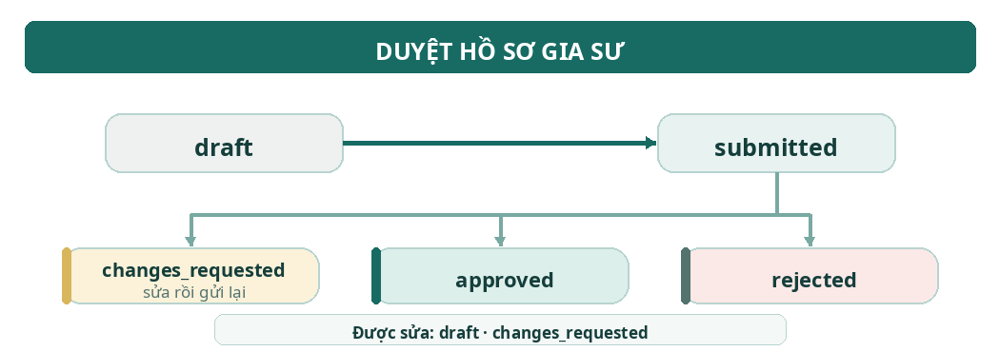
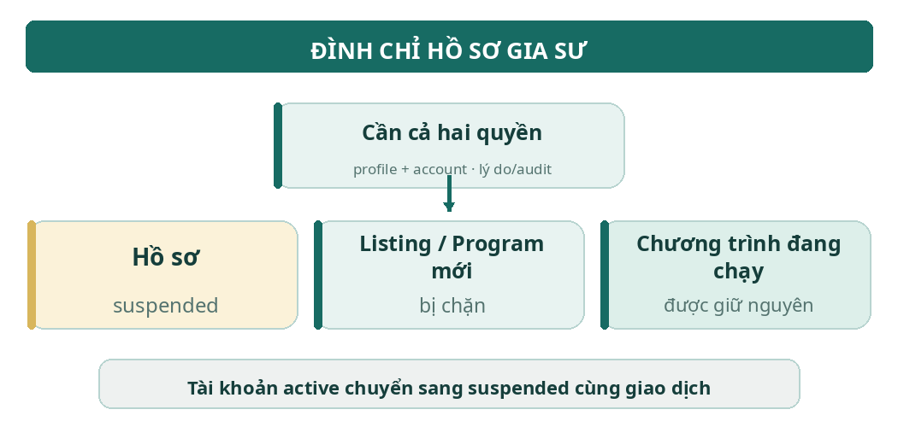
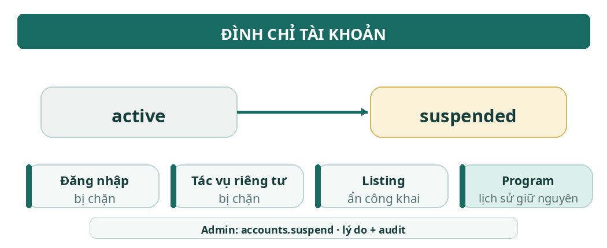
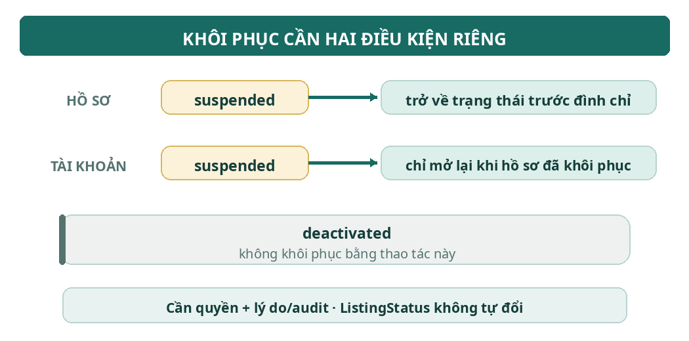
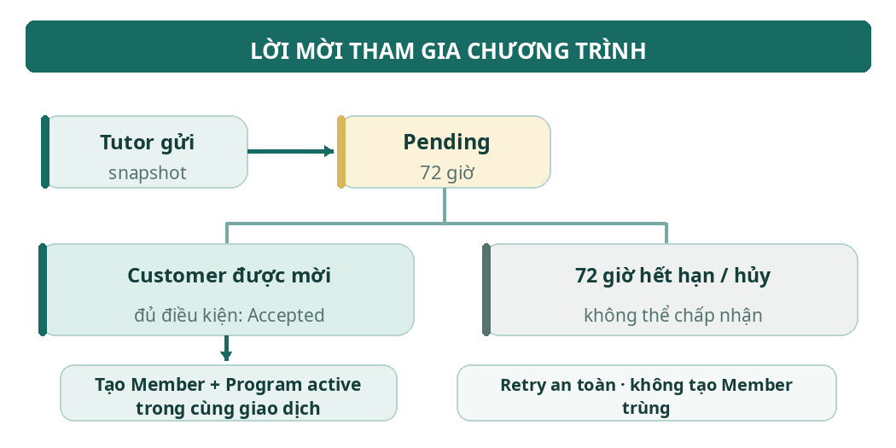
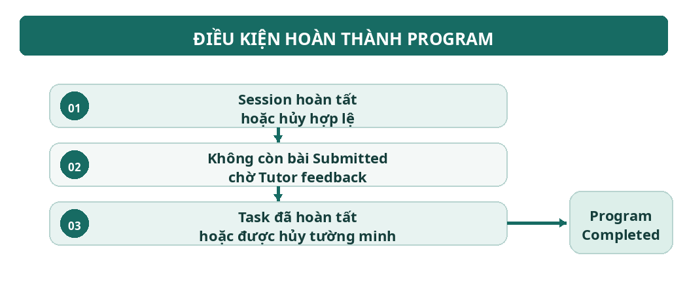
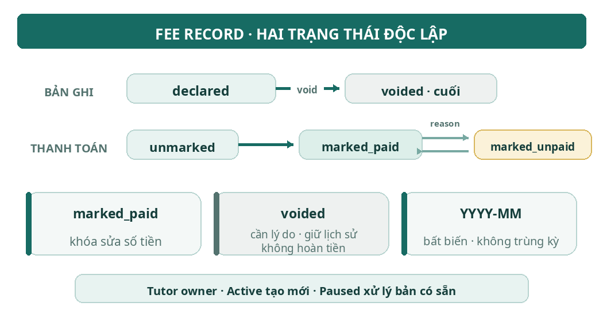
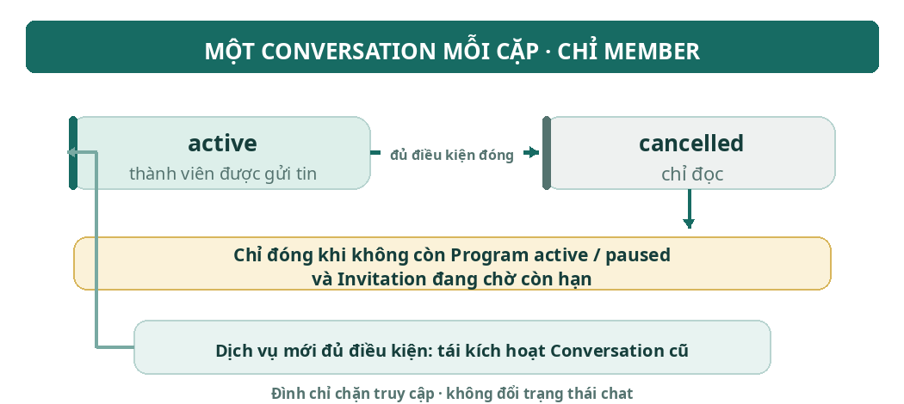
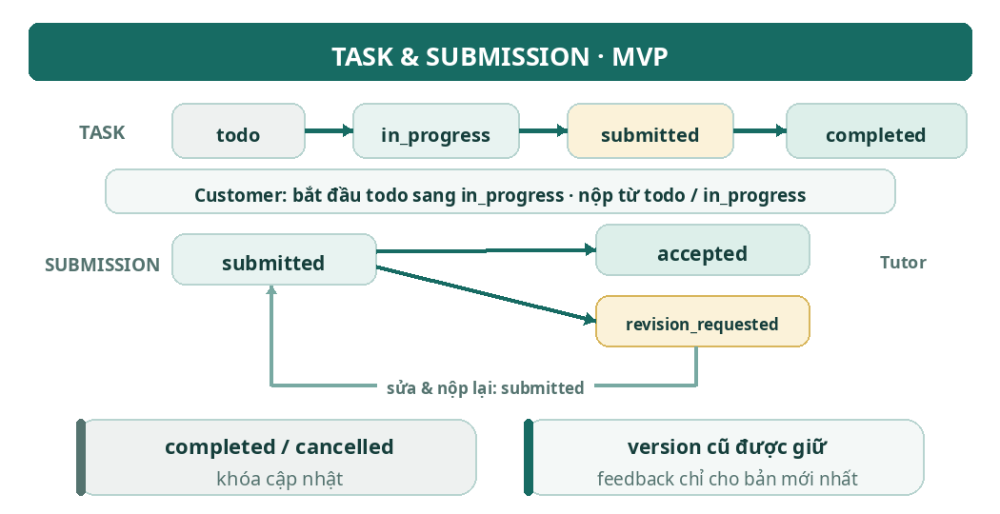
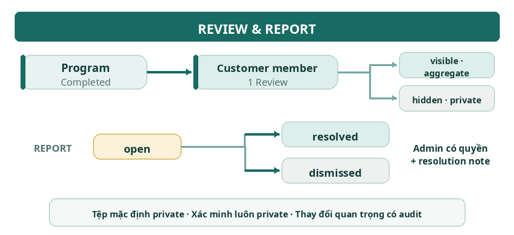

# Business Rules

| Tài khoản: | Customer từ đủ 15 tuổi, Tutor từ đủ 18 tuổi; `UserRole` cố định `customer`/`tutor`/`admin`, `RegisterRole` chỉ `customer`/`tutor`. `UserStatus` gồm `active`/`suspended`/`deactivated`; chỉ `active` được thao tác cần tài khoản hoạt động. `deactivated` dành cho quy trình vô hiệu hóa riêng, không được dùng thay `suspended`; không mở quy trình này trong MVP nếu chưa được hỗ trợ. `EmailVerificationState` `verified`/`unverified` suy ra từ `email_verified_at`. |
| :---- | ----- |
| **Điều kiện Tutor:** | **Tutor đủ điều kiện quản lý Listing, tạo Program và gửi Invitation khi UserStatus active, EmailVerificationState verified và TutorProfileStatus approved và giấy tờ bắt buộc còn hiệu lực theo BR-16; suspended không đủ điều kiện. Chỉ Customer đích là actor accept Invitation. Khi accept, server kiểm lại Customer và Tutor liên quan còn đủ điều kiện.** |
| **Hiển thị:** | **Listing chỉ công khai khi ListingStatus active, không có moderation hold, UserStatus active, email verified, hồ sơ approved, giấy tờ bắt buộc còn hiệu lực theo BR-16 và chuỗi catalog active. Điều kiện email verified cho public Listing/Profile được Dũng xác nhận ngày 18/10/2026. ListingStatus draft/active/inactive/archived; archive chuyển sang archived, không dùng cancelled. archived là lưu trữ cuối, không sửa/khôi phục. Mất điều kiện hiển thị không tự hủy Program.** |

# **Đình chỉ:** 

## 4.1. Tutor Profile Suspension



## 4.2. Account Suspension



## 4.3. Restoration



****

# **Workspace:** 

``

## **Hoàn thành:** 



# Tiền và phí:

* Tiền tệ sử dụng là VND; số tiền được lưu dưới dạng số nguyên không âm. Ví dụ: `200000` tương ứng `200.000 VND`.  
* Mỗi Program có tối đa một Fee Record cho mỗi tháng, được định danh bằng `program_id` và tháng theo định dạng `YYYY-MM`.  
* Fee Record do Tutor nhập thủ công; hệ thống không tự động tính Fee Record từ số Session.  
* Fee Record là thông tin phí được Tutor khai báo, không phải bằng chứng xác nhận thanh toán thực tế.



****

****

****

# State Consistency and Authorization

## Nguyên tắc bắt buộc

- **Server là nguồn quyết định:** Backend kiểm tra quyền, trạng thái và điều kiện nghiệp vụ; kiểm tra Frontend chỉ phục vụ UI.
- **Không hợp lệ → từ chối an toàn:** Không tạo side effect, không ghi đè dữ liệu mới hơn.
- **Chống stale update:** Mutation cần kiểm tra version khi quy tắc chức năng yêu cầu; version sai trả `409 Conflict`.
- **Tính nguyên tử:** Các thay đổi liên quan, audit và outbox phải cùng transaction khi được quy định; worker chỉ xử lý sau commit.
- **Chi tiết kỹ thuật:** Isolation/locking, uniqueness, idempotency và mã lỗi cụ thể được đặc tả tại tài liệu API/Database/thiết kế tương ứng.

## Các gate nghiệp vụ chính

```text
Request
  └─> Kiểm tra actor + permission
       └─> Kiểm tra trạng thái + eligibility + resource scope
            └─> Kiểm tra version / idempotency (nếu áp dụng)
                 ├─ Không đạt → từ chối, không ghi một phần
                 └─ Đạt → mutation + audit/outbox trong transaction
                            └─ Commit → worker xử lý outbox
```

| Trường hợp | Quy tắc cốt lõi |
|---|---|
| Session | `program_sessions` là lịch dự kiến, không chứng minh buổi học đã diễn ra. Chỉ Tutor owner được hoàn tất; chuyển Session sang `completed` và tạo tối đa một `lesson_sessions` trong cùng transaction. Hủy → `cancelled`, không tạo kết quả thực hiện. Chỉ đếm `lesson_sessions` đã hoàn tất. |
| Admin assignment | Tutor Profile/Report có tối đa một Admin được giao; `NULL` = chưa phân công. Assignment không tự cấp permission. Mỗi request phải kiểm tra permission, assignment và scope hiện tại; đổi assignment phải audit/version và Admin cũ mất scope từ request tiếp theo. |
| Eligibility & visibility | Tạo/quản lý Listing cần Tutor active, email verified, Profile approved, giấy tờ bắt buộc còn hiệu lực và không bị đình chỉ. Public Listing còn cần `ListingStatus=active`, không moderation hold và catalog chain active. |
| Khôi phục | Khôi phục Account/Profile không tự đổi `ListingStatus`: Listing `active` chỉ hiện lại khi đủ mọi gate; `inactive` cần Tutor publish; `archived` là trạng thái cuối. Moderation hold có luồng restore riêng. |
| Availability | Tutor active, email verified và Profile không suspended có thể quản lý availability trước khi Profile approved. Availability chỉ là khung giờ tham khảo, không tạo Booking/Session/Program. |
| Conversation | Chỉ mở liên hệ khi các bên và điều kiện Tutor đạt gate. Mỗi cặp Customer–Tutor có một Conversation; context Listing ban đầu bất biến. Đình chỉ không xóa lịch sử; quyền đọc/gửi vẫn kiểm tra theo trạng thái và policy hiện tại. |
| Announcement | Tutor owner được tạo/sửa/publish khi Program `Active` hoặc `Paused`; Program `Completed`/`Cancelled` chặn tạo/publish mới. Publish, audit và outbox notification phải nhất quán; notification chỉ phát một lần. |
| Listing moderation | Admin active có `admin.listings.moderate` được hide/restore trong phạm vi MVP. Hide cần reason và audit; restore chỉ tự active khi đủ public gate, nếu không trả `409` và giữ hold. Không lộ reporter/evidence. |

# F19 — Sổ đăng ký quy tắc và truy vết

## Quy ước

- ID `BR-*`/`ADR-*` là tham chiếu ổn định giữa PRD và tài liệu nguồn.
- Nội dung trong sổ là **quy tắc đích/thiết kế**, không tự chứng minh Product đã duyệt hoặc runtime đã triển khai.
- Mọi xác nhận current-state phải có **ngày + commit/bằng chứng**. Thiếu bằng chứng → `unverified`; không tự gán owner.
- Các chi tiết API, schema, transaction và test thuộc tài liệu chức năng/kỹ thuật được liên kết bên dưới.

## Danh mục quy tắc

| ID | Chủ đề | Quy tắc cốt lõi |
|---|---|---|
| ADR-09 | Đồng thời khi accept Invitation | Thứ tự khóa hiện ghi: Customer User → Tutor Profile → Program → Invitation. Chưa đủ để xác nhận an toàn khi accept cạnh tranh với suspend; owner kỹ thuật cần chốt locking/isolation và kiểm thử PostgreSQL trước phát hành. |
| BR-10 | Program Paused | Cho đọc; chặn tạo Session/Task/Fee mới. Chỉ cho phép các thao tác đang tiếp diễn được PRD nêu rõ. Announcement vẫn được tạo/sửa/publish khi Paused. |
| BR-11 | Admin đọc evidence Report | Chỉ Admin active có `admin.reports.view`, được giao Report đang `open` mới đọc evidence. Với message report, chỉ trả message bị báo cáo và tối đa 10 message trước + 5 sau; kiểm tra quyền/scope và audit mỗi lần đọc. |
| BR-12 | Đăng ký & phiên | Customer ≥15 tuổi, Tutor ≥18 tuổi; lưu version điều khoản và thời điểm đồng ý. Tài khoản unverified chưa được đăng nhập; xác minh email trước login. Reset mật khẩu vô hiệu hóa các phiên cũ. Runtime còn chênh lệch cần đồng bộ. |
| BR-13 | Customer Profile | Customer active quản lý profile của mình; profile không bắt buộc. GET chưa có row trả `profile: null`; PUT upsert theo field, omission giữ nguyên, `null` xóa field nullable. Avatar phải là File hợp lệ đúng owner/purpose. |
| BR-14 | Public Tutor/Listing | Chỉ trả field allow-list; Listing public phải qua toàn bộ eligibility/visibility gate. Slug tạo một lần, không đổi theo tên; sửa Listing active có kiểm tra server, audit; snapshot Program/Invitation cũ không đổi. |
| BR-15 | Listing moderation | Admin active có `admin.listings.moderate` được hide/restore mọi Listing trong MVP. Bắt buộc reason + audit + notification sau thành công; không lộ reporter/evidence. Restore thiếu public gate → `409`, giữ hold. |
| BR-16 | Tutor Profile & giấy tờ | Hồ sơ gửi xét duyệt cần thông tin tối thiểu, avatar hợp lệ và giấy tờ định danh bắt buộc. Chỉ duyệt Profile khi giấy tờ bắt buộc đã approved và còn hạn. Giấy tờ bắt buộc hết hạn làm mất eligibility, không tự suspend hay hủy Program/snapshot. |
| BR-17 | Conversation | Server suy ra cặp Customer–Tutor, kiểm gate và bảo đảm một Conversation cho mỗi cặp. Context Listing đầu tiên bất biến. Suspend không xóa membership/lịch sử; Admin chỉ xem evidence qua Report theo BR-11. |
| BR-18 | Program & Invitation lifecycle | Draft dùng `Program.version`; sửa/gửi Invitation phải kiểm `expected_version`. Invitation lưu snapshot và hết hạn sau 72 giờ từ `sent_at`. Accept/expire/cancel phải có một kết quả terminal duy nhất; hold chặn accept trong thời gian hold. Hủy Program phải xử lý blocker Session/Task tường minh. |
| BR-19 | Workspace khi Paused & stale update | Paused chặn tạo Session/Task/Fee mới nhưng cho phép một số thao tác trên resource hiện có theo trạng thái. Announcement published bất biến. Resource version bắt đầu từ 1; mutation kiểm `expected_version`; replay idempotent không lặp version/audit/notification. |
| BR-20 | Quy ước Workspace | Dùng `Program.timezone` (mặc định `Asia/Ho_Chi_Minh`), lưu instant UTC và API timestamp RFC 3339. Summary chọn latest/next theo thứ tự xác định; Progress là số nguyên 0–100. Payload, file và validation theo giới hạn trong BR-20. |
| BR-21 | Messaging & Files | Chỉ member được đọc Conversation; gửi tin cần kiểm tra trạng thái/quota/idempotency. Message tối đa 4.000 ký tự; 30 tin mới/phút/người dùng. File phải đúng owner/purpose, private, qua kiểm tra size/MIME/checksum và malware scan trước khi dùng. |
| BR-22 | Fee Record | Mỗi Program/tháng tối đa một record; chỉ tạo khi Program Active, trong khoảng từ tháng kích hoạt đến tháng hiện tại. `0` là miễn phí, khác với chưa khai báo. Thay tiền/void cần reason + audit; record là khai báo của Tutor, không phải bằng chứng thanh toán. |

## Ma trận truy vết

| Quy tắc | Tài liệu liên quan |
|---|---|
| ADR-09 | M05-F03 |
| BR-10 | M05-F06, M06-F01, M07-F02/F04 |
| BR-11 | M04-F08, M09-F04, M10-F04, WF06, API Route Catalog |
| BR-12 | M01-F01/F02/F03/F06/F07, Security & Privacy, Database Design, API Route Catalog |
| BR-13 | M01-F07, WF01, M10-F05, API Route Catalog |
| BR-14 | M03-F02/F08, M10-F04, State Lifecycles, API Route Catalog |
| BR-15 | M03-F10, M05-F01/F02, M08-F03, Enum Catalog, State Lifecycles, API Route Catalog |
| BR-16 | M02-F01/F02/F03/F05/F06/F07, WF01, Enum Catalog, State Lifecycles, Database Design |
| BR-17 | M04-F01/F02/F03/F07, State Lifecycles, Database Design, API Route Catalog |
| BR-18 | M05-F01/F02/F03/F04/F05/F06, M03-F10, WF04, State Lifecycles, Database Design, API Route Catalog |
| BR-19 | M06-F02/F03, M07-F01/F02/F03, M08-F01/F02/F03/F04, WF05, State Lifecycles, Database Design |
| BR-20 | M06-F01/F02, M07-F02/F03/F04, M08-F01/F02, M10-F01/F03, WF05, Database Design |
| BR-21 | M04-F02/F04/F06/F07, M10-F01/F02/F03/F04/F05, WF03, Security & Privacy, State Lifecycles, Database Design |
| BR-22 | M08-F01/F03, WF05, Enum Catalog, Domain Model, State Lifecycles, Database Design, API Route Catalog |

## Trạng thái triển khai

**Chưa xác minh nếu chưa có bằng chứng.** Liên kết API/DB/migration/test và commit phải được kiểm tra trước khi cập nhật trạng thái triển khai. PRD/index giữ trạng thái `draft` hoặc `unverified` cho đến khi owner bổ sung bằng chứng.
