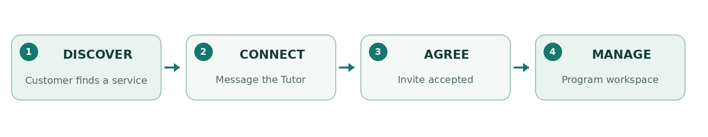
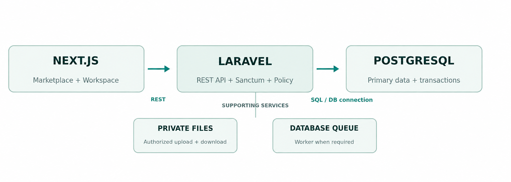

# **TUTORLINK VIETNAM**

## TỔNG QUAN DỰ ÁN

MVP · Kế hoạch triển khai 4 tuần · Việt Nam · Cập nhật ngày 18 tháng 10 năm 2026

# **1\. Tóm tắt dự án**

Sàn dịch vụ đa lĩnh vực, nơi người dùng chưa đăng nhập có thể xem các dịch vụ công khai; Khách hàng đã đăng ký kết nối với Gia sư và Huấn luyện viên, sau đó phối hợp việc cung cấp dịch vụ trong không gian Chương trình dùng chung.

# **2\. Tóm lược điều hành & giá trị**

Người dùng chưa đăng nhập có thể xem hồ sơ Gia sư đã được duyệt và các Tin dịch vụ đang hoạt động. Khách hàng đã đăng ký tìm dịch vụ, bắt đầu trò chuyện và tham gia Chương trình riêng sau khi hai bên thống nhất. Gia sư sử dụng không gian Chương trình để điều phối buổi học, nhiệm vụ và tiến độ.

| KHÁM PHÁ | KẾT NỐI | ĐIỀU PHỐI |
| :---- | :---- | :---- |
| Khám phá dịch vụ của Gia sư đã được duyệt | Trao đổi trước khi thống nhất | Điều phối công việc qua Chương trình |

# **3\. Vấn đề, mục tiêu & kết quả**

| THÁCH THỨC | GIẢI PHÁP CỦA TUTORLINK |
| :---- | :---- |
| Thông tin Gia sư bị phân tán | Tin dịch vụ có thể tìm kiếm và hồ sơ công khai |
| Công việc liên tục được điều phối qua nhiều công cụ rời rạc | Không gian Chương trình dùng chung |
| Mức độ tin cậy không đồng nhất giữa các kênh | Duyệt Gia sư, đánh giá hợp lệ và báo cáo |

Kết quả MVP: hoàn tất một hành trình thực tế, từ duyệt Gia sư và khám phá dịch vụ đến Chương trình được chấp nhận, công việc được điều phối và đánh giá hợp lệ.

# **4\. Vai trò tài khoản & trạng thái truy cập**

| VAI TRÒ TÀI KHOẢN / TRẠNG THÁI TRUY CẬP | HÀNH ĐỘNG CHÍNH | PHẠM VI TRUY CẬP |
| :---- | :---- | :---- |
| Trạng thái: chưa đăng nhập | Duyệt, tìm kiếm Tin dịch vụ công khai và xem hồ sơ Gia sư đã được duyệt | Đây là trạng thái truy cập công khai, không phải vai trò tài khoản. Chỉ xem dữ liệu công khai; không nhắn tin, truy cập Chương trình, đánh giá hay dữ liệu riêng tư. |
| Khách hàng | Tìm dịch vụ, nhắn tin, tham gia Chương trình và đánh giá công việc đã hoàn thành | Khách hàng từ đủ 15 tuổi; chỉ truy cập Chương trình của mình. |
| Gia sư | Đăng dịch vụ và quản lý Chương trình | Gia sư từ đủ 18 tuổi; chỉ được đăng Tin dịch vụ/tạo Chương trình khi tài khoản đang hoạt động, email đã xác minh, hồ sơ được duyệt và không bị đình chỉ; chỉ quản lý tài nguyên của mình. |
| Quản trị viên | Duyệt hồ sơ Gia sư và xử lý báo cáo | Theo quyền được phân công |

Vai trò chuẩn: Customer (Khách hàng), Tutor (Gia sư), Admin (Quản trị viên); tài liệu hiện giữ nhãn tiếng Việt để tiện đọc. Mô hình sản phẩm: Người dùng chưa đăng nhập được xem hồ sơ công khai đã duyệt và Tin dịch vụ đang hoạt động; Hồ sơ Gia sư mô tả người cung cấp dịch vụ; Tin dịch vụ giới thiệu một dịch vụ; Cuộc trò chuyện kết nối một cặp Customer–Tutor đã đăng ký; Chương trình ghi nhận thỏa thuận riêng và công việc của hai bên. Khi hồ sơ Tutor bị đình chỉ, Tin dịch vụ bị ẩn, tài khoản bị khóa; Chương trình đang hoạt động không tự hủy và dữ liệu lịch sử được giữ.

# **5\. Hành trình chính & chức năng**

  
Lời mời tham gia Chương trình có hiệu lực 72 giờ; lời mời hết hạn không thể chấp nhận và cần được gửi lại. Không gian Chương trình có sáu mục: Tổng quan, Buổi học, Nhiệm vụ, Tiến độ, Thông báo và Khoản phí.

# **6\. Phạm vi & giới hạn MVP**

| PHẠM VI CỐT LÕI | SAU PHẦN CỐT LÕI | NGOÀI PHẠM VI |
| :---- | :---- | :---- |
| Duyệt Gia sư Tin dịch vụ và tìm kiếm Hồ sơ công khai Nhắn tin REST Chương trình và sáu mục Đánh giá và báo cáo | Reverb Yêu thích Thư viện ảnh và nội dung giới thiệu Biểu đồ nâng cao | Thanh toán trực tuyến Đặt khung giờ Video tích hợp Thuê bao, AI và ứng dụng di động Chương trình nhóm |

Thông tin về thời gian rảnh chỉ có tính tham khảo. Bản ghi khoản phí là thông tin do người dùng khai báo, không xác nhận đã thanh toán. Điểm danh, thư viện tệp của Chương trình và tệp đính kèm trực tiếp vào Buổi học nằm ngoài MVP bốn tuần.

# **7\. Kiến trúc & chất lượng**

| QUY MÔ | HIỆU NĂNG | TRUY CẬP & TÍNH SẴN SÀNG |
| :---- | :---- | :---- |
| 5.000 tài khoản 500–1.000 người dùng hoạt động hàng tháng (MAU) 50 người dùng đồng thời; cao điểm ngắn hạn 100 người | API p95 \< 2 giây Tìm kiếm \< 3 giây | Mục tiêu nội bộ: 99% Tiếng Việt Điện thoại 360 px / máy tính bảng 768 px / máy tính Bàn phím |

Cookie phiên Sanctum và CSRF bảo vệ xác thực; các chính sách phân quyền ở máy chủ kiểm soát quyền truy cập tài nguyên. Giao dịch và ràng buộc PostgreSQL bảo đảm việc chấp nhận chỉ diễn ra một lần và dữ liệu thành viên nhất quán.

# **8\. Chỉ số thành công & cổng nghiệm thu**

| CỔNG | TRỌNG TÂM | BẰNG CHỨNG NGHIỆM THU |
| :---- | :---- | :---- |
| G1 · Sàn dịch vụ | Tin dịch vụ, tìm kiếm và trang chi tiết công khai | API thực; quy trình duyệt; từ 3 danh mục trở lên |
| G2 · Kết nối | Nhắn tin và lời mời tham gia Chương trình | Trò chuyện theo cặp; chấp nhận nguyên tử; kiểm tra tranh chấp trên PostgreSQL |
| G3 · Không gian làm việc | Sáu mục và chức năng tạo dựng niềm tin | Vòng đời; đánh giá; thông báo; báo cáo |
| G4 · Sẵn sàng trình diễn | Bàn giao xuyên suốt | Kiểm thử đầu cuối; quyền truy cập; tương thích nhiều kích cỡ màn hình; triển khai; khôi phục |

Mỗi cổng cần có bằng chứng đầy đủ cho toàn bộ phạm vi và được người nghiệm thu chỉ định chấp thuận. Bản mô phỏng giao diện hoặc một bài kiểm thử riêng lẻ thành công không đủ để đóng cổng.

# **9\. Lộ trình, tình trạng, rủi ro & sản phẩm bàn giao**

| GIAI ĐOẠN | TRỌNG TÂM TRIỂN KHAI | CỔNG |
| :---- | :---- | :---- |
| Tuần 1 | Nền tảng; tích hợp API và giao diện sàn dịch vụ | G1 |
| Tuần 2 | Nhắn tin; Chương trình; lời mời | G2 |
| Tuần 3 | Không gian làm việc; đánh giá; báo cáo; thông báo | G3 |
| Tuần 4 | Kiểm thử đầu cuối; chất lượng; triển khai; sao lưu; bàn giao | G4 |

## Tình trạng · bằng chứng cập nhật đến ngày 13 tháng 10 năm 2026

Xác thực, xử lý tệp và chức năng Quản trị viên là nền tảng hiện có. Tài liệu ghi nhận giao diện sàn dịch vụ đã sẵn sàng; tại thời điểm bằng chứng mới nhất, việc tích hợp API thực và nghiệm thu G1 vẫn chưa hoàn tất. G2–G4 chưa có bằng chứng được chấp thuận trong bản cập nhật đó.

| RỦI RO | BIỆN PHÁP ỨNG PHÓ |
| :---- | :---- |
| Phạm vi vượt quá bốn tuần | Giữ ưu tiên cho các hạng mục bắt buộc và dành thời gian cho QA |
| Hợp đồng giữa giao diện và máy chủ không đồng bộ | Thống nhất DTO, trạng thái và thao tác theo từng phần chức năng |
| Rò rỉ dữ liệu riêng tư hoặc thao tác bị lặp | Chính sách phân quyền, ràng buộc dữ liệu, giao dịch và kiểm tra tranh chấp |

Sản phẩm bàn giao: ứng dụng web tương thích nhiều kích cỡ màn hình và API · các migration cơ sở dữ liệu và dữ liệu mẫu trình diễn · bằng chứng kiểm thử và nghiệm thu · hướng dẫn thiết lập, triển khai và bàn giao.
