# WF01 Tài khoản và duyệt hồ sơ Tutor

## 01 Đăng ký và đọc tài khoản

**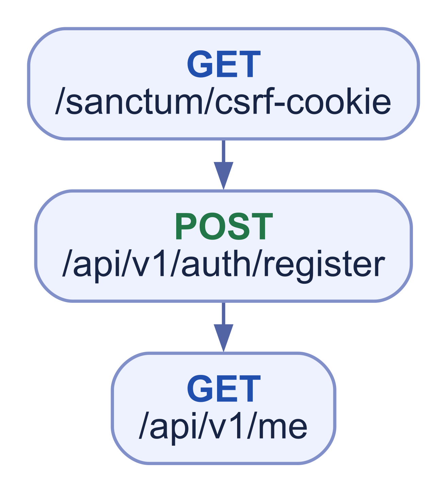**

Customer từ 15 tuổi; Tutor từ 18 tuổi; role không tự thay đổi. Form hiển thị phiên bản điều khoản và yêu cầu đồng ý chủ động; server lưu version và thời điểm đồng ý. Đăng ký tạo tài khoản unverified và gửi email nhưng không tạo session; hình nhúng register → GET /me là luồng cũ, không phải quy tắc đích. Người dùng xác minh email trước rồi mới đến trang đăng nhập; GET /me chỉ dùng sau login thành công. Ngày sinh sau đăng ký được sửa từ màn hình hồ sơ qua PATCH /me với tuổi theo role.

## 02 Đăng nhập và đăng xuất

**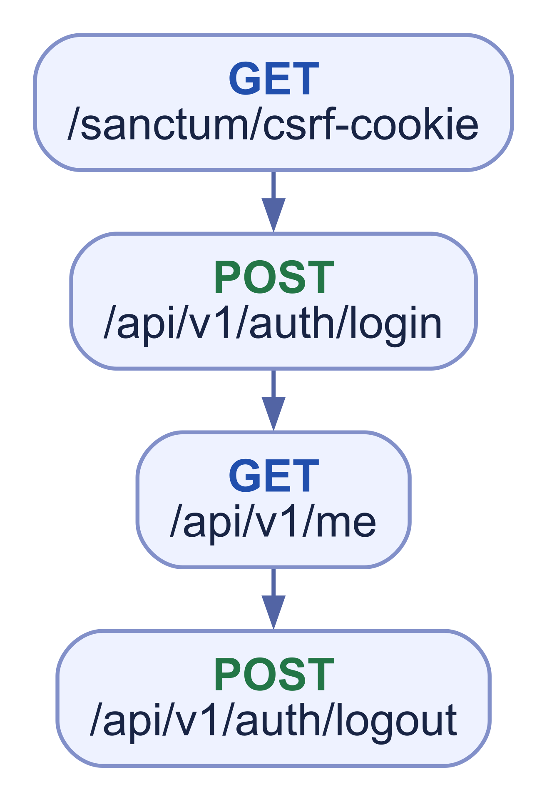**

## 03 Xác minh email

**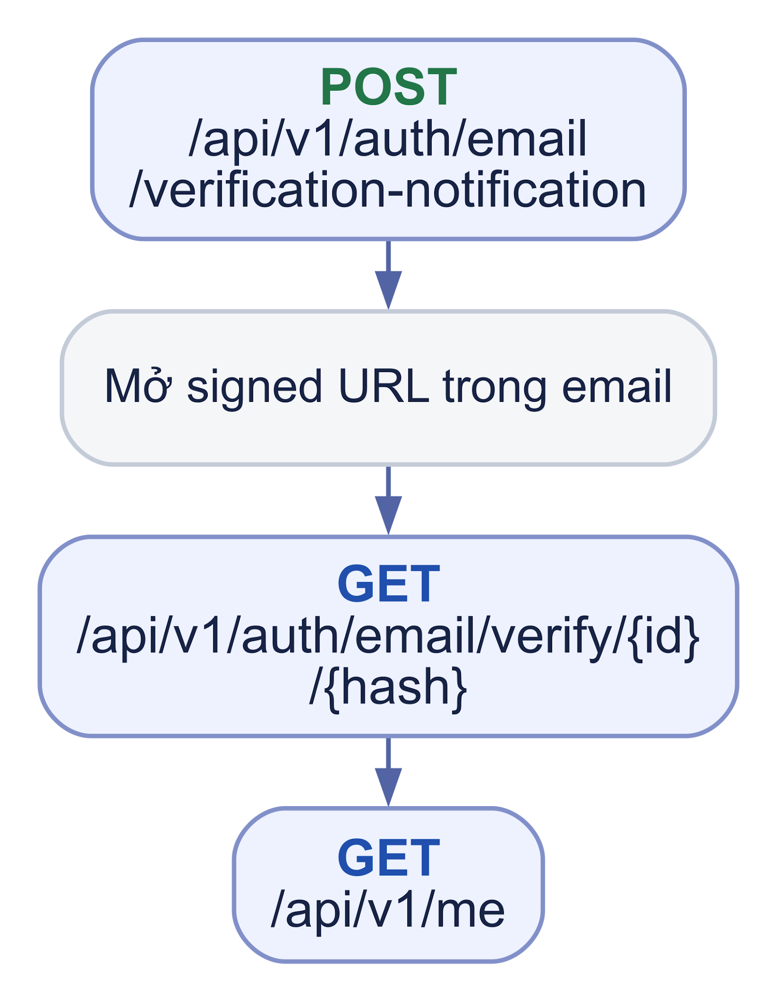**

Bước GET được mở từ signed URL trong email. Xác minh thành công chuyển người dùng đến trang đăng nhập và không tự tạo session. Gửi lại email phải dùng được khi chưa đăng nhập qua cùng route Catalog, với phản hồi trung tính và rate limit; hình nhúng nếu thể hiện resend cần session là luồng cũ.

## 04 Quên mật khẩu

**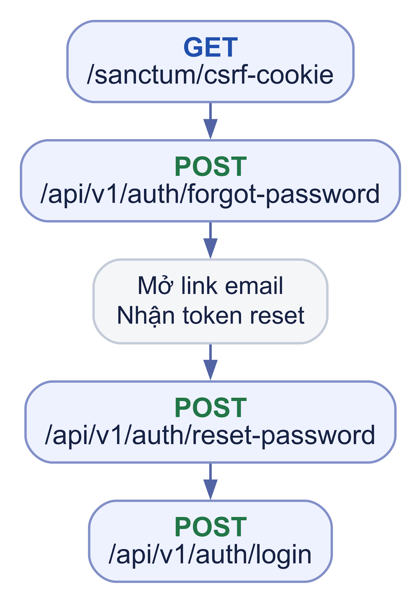**

Reset nhận token từ link email; bootstrap lại CSRF nếu phiên đã hết. Reset thành công thu hồi mọi phiên đăng nhập có trước, nên các thiết bị phải đăng nhập lại.

## 05 Settings và Customer Profile

**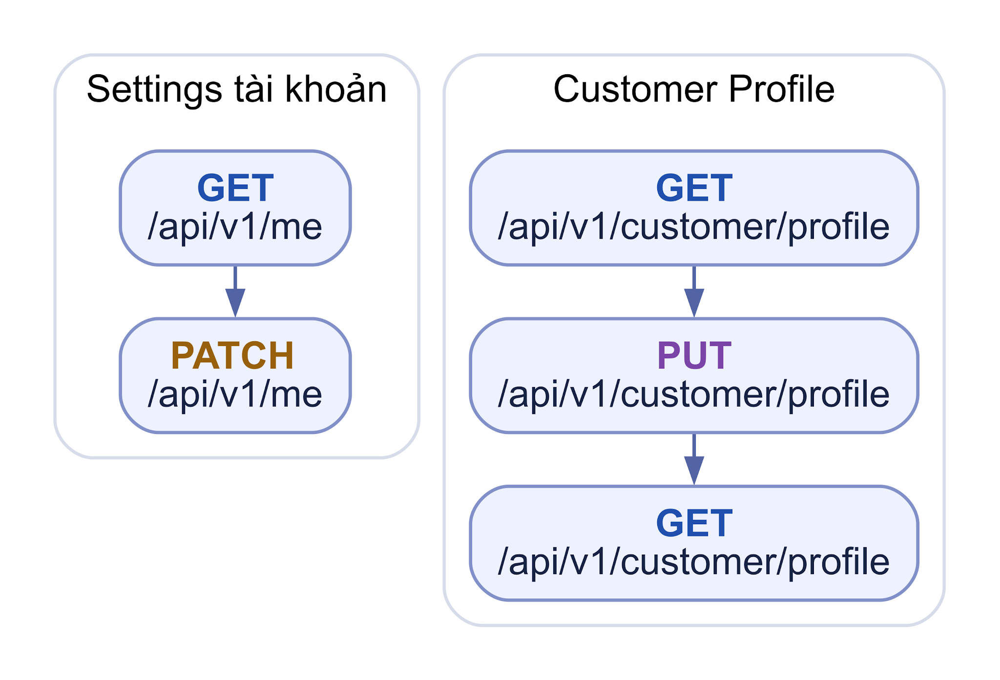**

Hai phần độc lập: account fields và Customer Profile của chính mình.

D09 đã chốt: Customer active xem/sửa profile tùy chọn của mình qua GET/PUT `/api/v1/customer/profile`. Chưa có profile thì GET trả `profile: null` mà không tạo row; PUT upsert, field vắng mặt giữ nguyên, `null` gỡ field nullable. Họ tên/ngày sinh sửa qua PATCH `/api/v1/me`. Avatar phải là File complete đúng owner/purpose, thay/gỡ liên kết không tự xóa File cũ. Hai route Customer Profile vẫn Dự kiến, chưa phải API khả dụng.

## 06 Tạo hoặc sửa Draft Tutor

**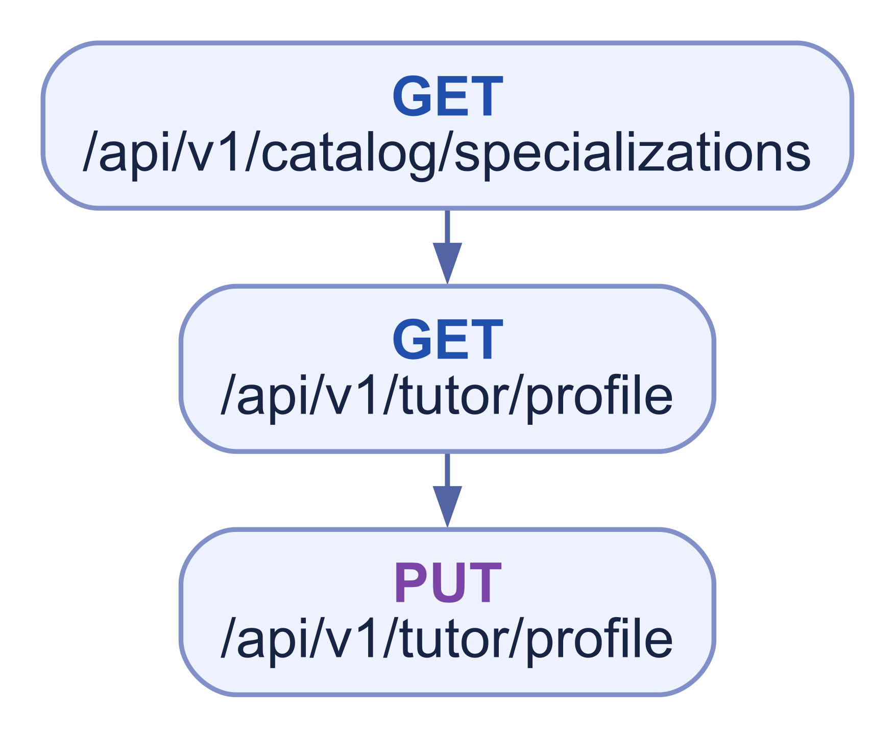**

Draft/Changes Requested được sửa trực tiếp; Profile approved được sửa qua revision chờ duyệt, bản công khai cũ giữ nguyên. Catalog lấy chuyên môn visible. Sơ đồ nhúng là luồng cũ nếu chỉ cho sửa Draft/Changes Requested.

## 07 Gắn avatar

**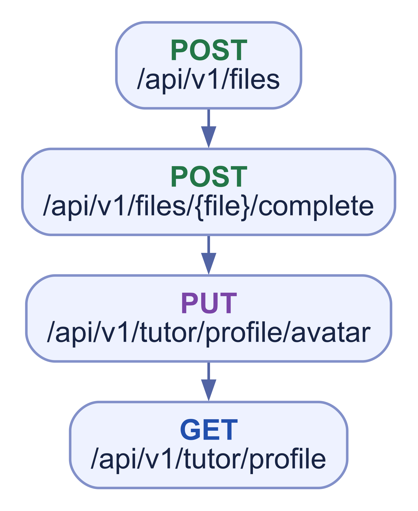**

## 08 Gắn giấy tờ và gửi duyệt

**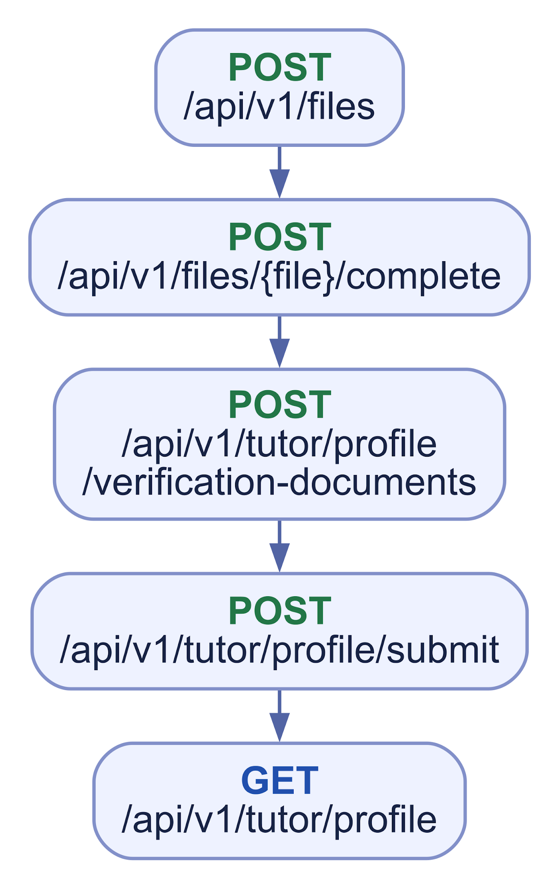**

## 09 Admin xem và review giấy tờ

**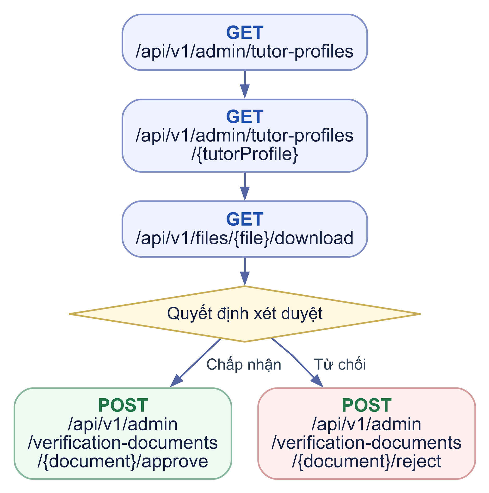**

BR-16 đã chốt: trước submit cần identity_card hoặc passport complete, avatar hợp lệ và checklist Profile; Admin được giao có `admin.verification_documents.decide` quyết định từng giấy tờ, reject cần reason/audit. Chỉ duyệt Profile khi giấy tờ bắt buộc approved và còn hạn; không tự approve giấy tờ theo quyết định Profile. Download vẫn cần permission riêng. Hai route POST /api/v1/admin/verification-documents/{document}/approve và /reject trong Catalog vẫn “Dự kiến”, chưa là API khả dụng. Thay file tạo document mới; giấy tờ bắt buộc expired làm ẩn public/chặn dịch vụ mới nhưng không tự suspend. Sơ đồ nhúng chưa thể hiện đủ quy tắc mới.

## 10 Yêu cầu sửa và gửi lại

**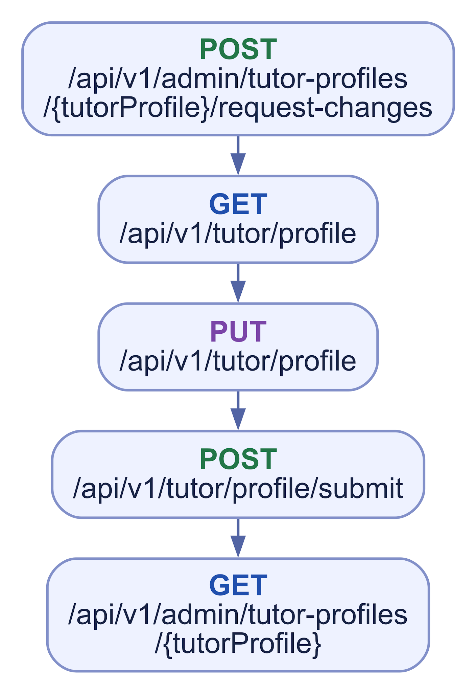**

## 11 Duyệt hoặc từ chối hồ sơ

**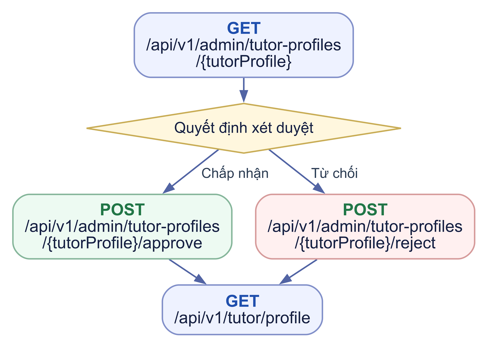**

Nhánh từ chối dùng POST /api/v1/admin/tutor-profiles/{tutorProfile}/reject, không gọi cả approve và reject.

## 12 Đình chỉ và khôi phục hồ sơ

**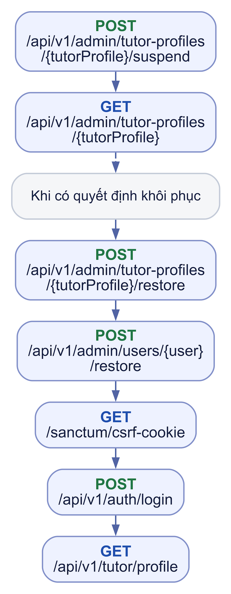**

Suspend hồ sơ kèm khóa account cần đủ hai permission; restore hồ sơ trước, account sau.

## 13 Đình chỉ riêng tài khoản

**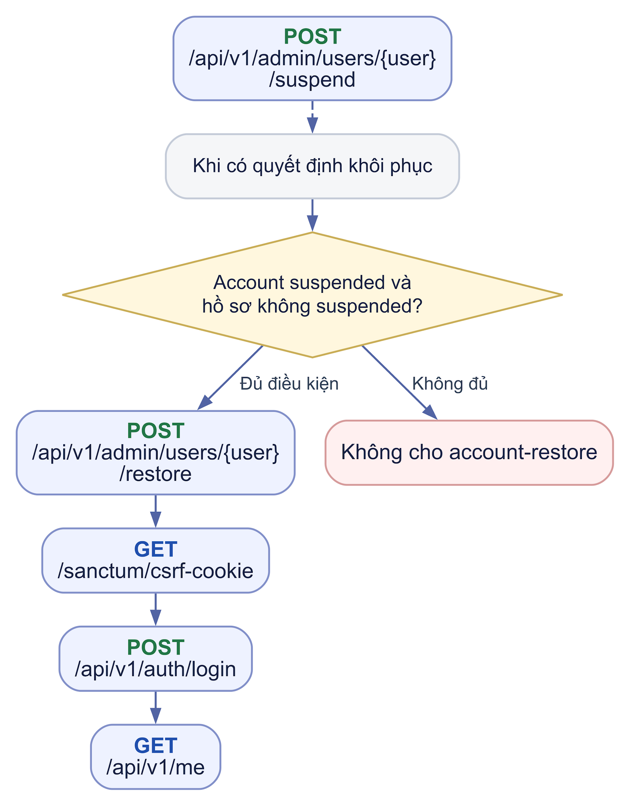**

Chỉ Admin đúng quyền; account-restore không mở deactivated hoặc hồ sơ còn suspended.

F03 — Bước phân công hồ sơ Tutor  
Sau khi hồ sơ được gửi, hồ sơ chưa có người phụ trách có thể hiện trong queue metadata tối thiểu. Coordinator có admin.tutor\_profiles.assign chọn một Admin nội bộ active có quyền review; hệ thống ghi assignment/version/audit. Chỉ Admin có quyền xem và đang được giao mới mở chi tiết; quyết định luôn kiểm tra lại assignment. Khi Tutor gửi lại hồ sơ hoặc revision, giữ Admin hiện tại nếu còn active/đủ quyền; nếu không đưa về unassigned queue. Sơ đồ nhúng cần được cập nhật nếu thể hiện khác.
