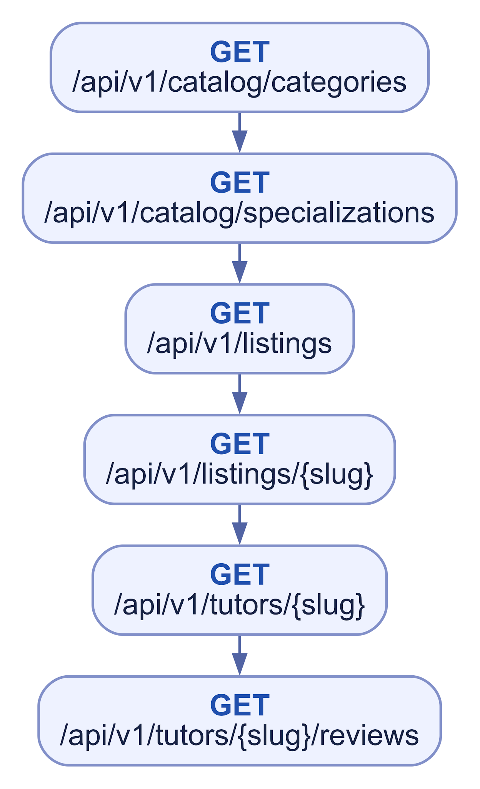
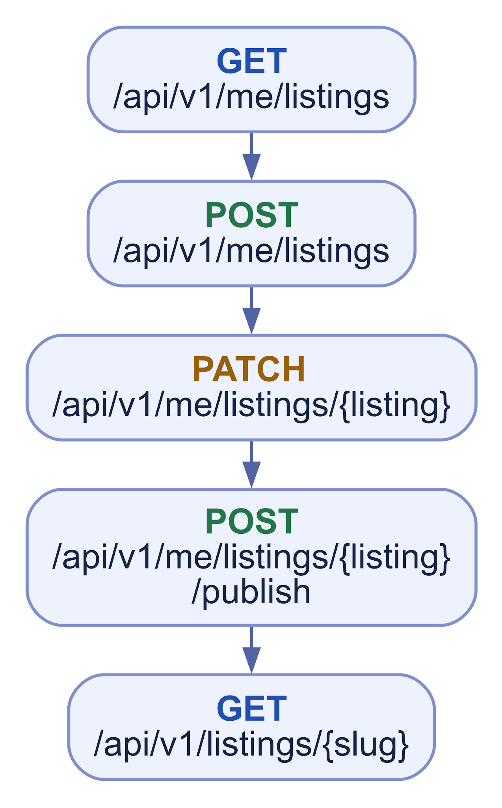
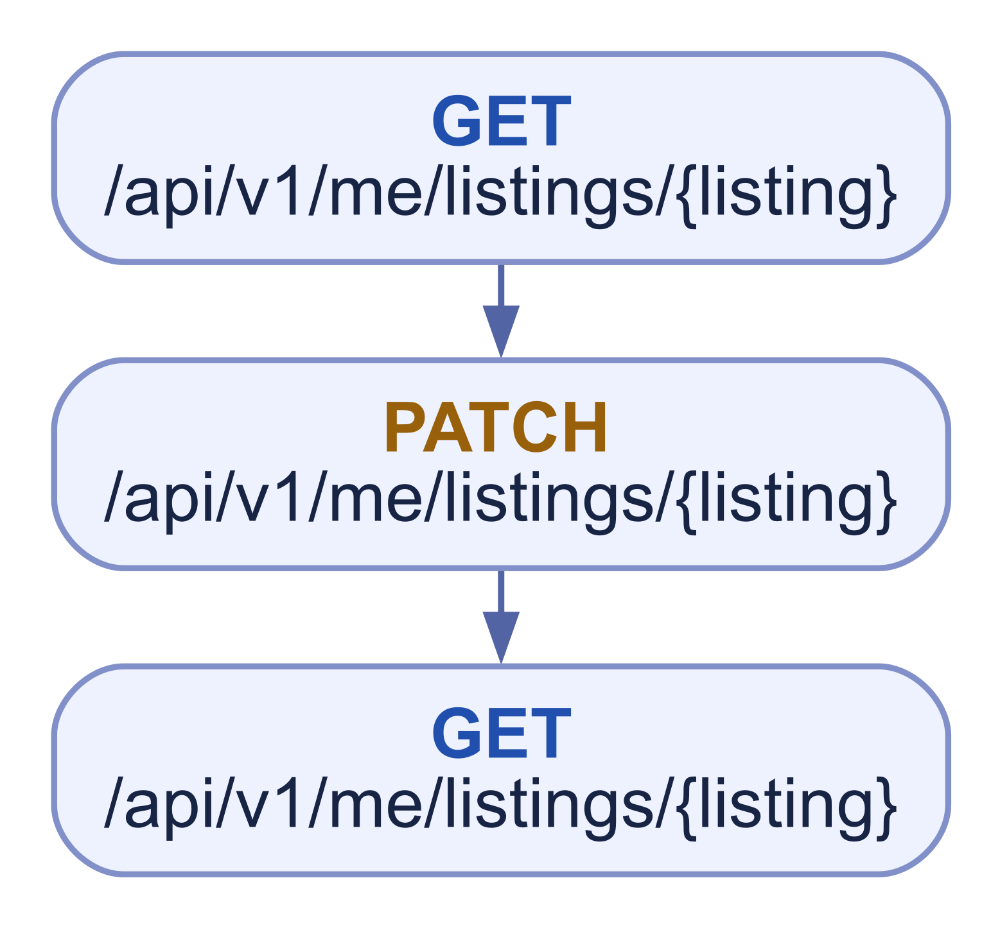
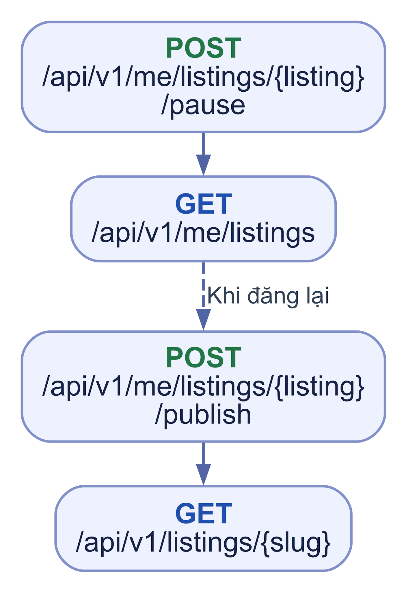
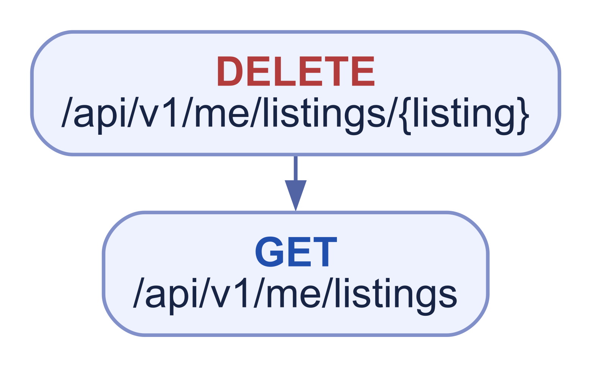
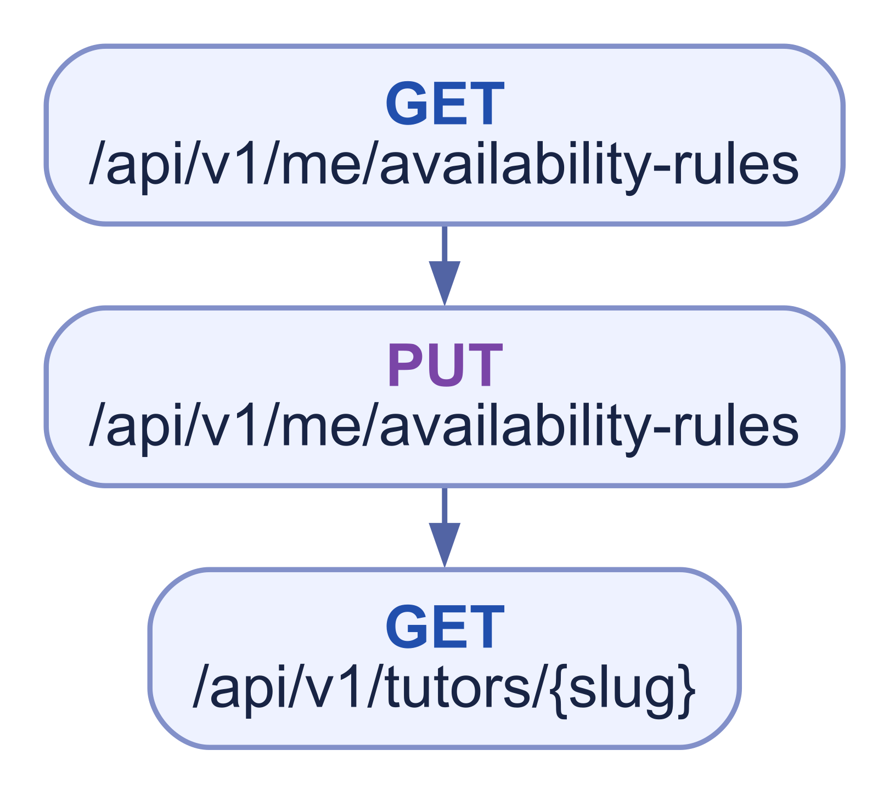
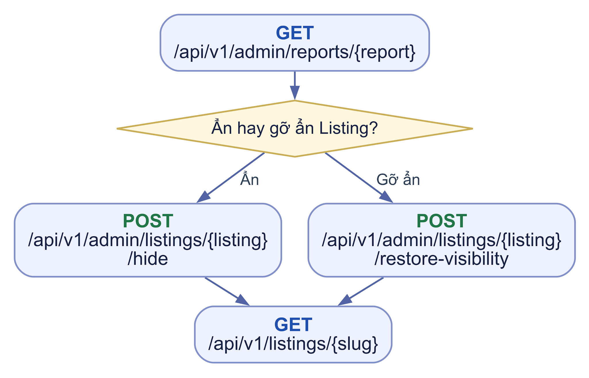
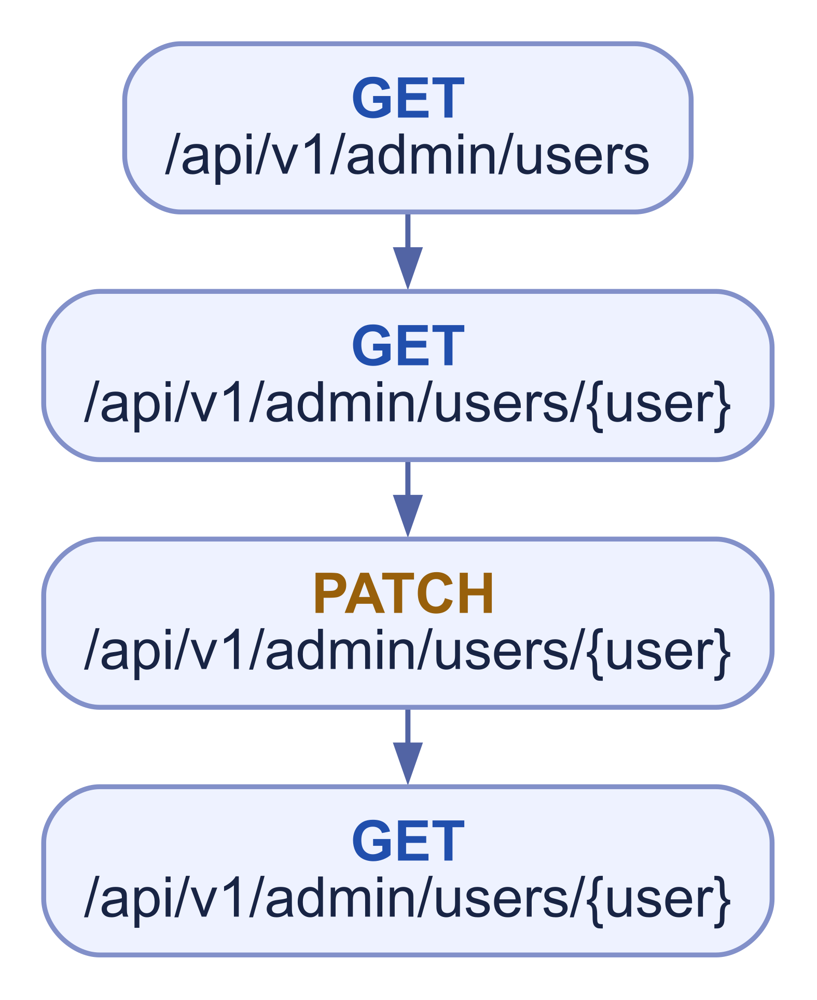
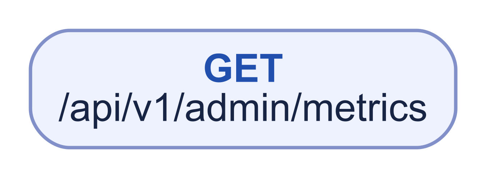

# WF02 Marketplace Listing và lịch rảnh

## 01 Khám phá dịch vụ công khai

****

D06 đã chốt: Public Tutor chỉ trả field allow-list, avatar hợp lệ và tối đa 10 Listing visible/trang qua GET `/api/v1/tutors/{slug}?listings_page=N`; `listings_meta` chỉ trang tiếp theo. Slug Tutor tạo một lần kèm ID, đổi tên không đổi URL. Search, detail và hồ sơ dùng cùng public gate; khi User/Profile được khôi phục, Listing vốn active đủ gate tự hiện, inactive/archived không tự đăng lại. Avatar/File và cache phải ngừng phục vụ nội dung khi gate mất. Code hiện chưa đáp ứng đủ email gate, avatar và giới hạn Listing nhúng.

## 02 Tạo và đăng Listing

****

Chỉ Tutor đủ điều kiện; slug lấy từ response, owner quản lý bằng ID.

## 03 Sửa Listing của mình

****

Tutor owner được sửa Listing active bằng PATCH sau kiểm lại eligibility/dữ liệu; bản sửa hiện công khai ngay và có audit, còn Program/Invitation cũ giữ snapshot. Không đổi status bằng PATCH theo API đích; publish/pause dùng các route POST trong Catalog. Chống stale update vẫn theo quyết định D21–D22.

## 04 Tạm dừng và đăng lại

****

## 05 Lưu trữ Listing

****

Archive mềm thành archived, không restore; link public cũ không còn được trả dữ liệu Listing đó.

## 06 Cập nhật lịch rảnh tham khảo

****

0 \= Monday, 6 \= Sunday; không đặt hoặc giữ slot.

## 07 Admin ẩn và gỡ ẩn Listing có điều kiện

****

BR-15 đã chốt: Admin active có `admin.listings.moderate` xử lý mọi Listing trong MVP, không cần assignment riêng. Hide/restore phải có reason_code/reason, audit và notification cho Tutor sau thành công; hide ẩn khỏi public. Restore muốn tự active nhưng thiếu public gate trả 409 và giữ hold; Tutor đã tự pause thì có thể gỡ hold, giữ inactive. Listing có hold chặn Program Draft/Invitation mới tham chiếu nó; lịch sử không tự đổi. Hai route Admin vẫn Dự kiến.

## 08 Admin hỗ trợ người dùng có điều kiện

****

Chỉ đề xuất khi Product/Domain chốt quyền hỗ trợ và field allow-list.

## 09 Admin đọc chỉ số vận hành có điều kiện

****

Chưa nằm trong AdminPermission hiện tại; chỉ dữ liệu tổng hợp, không private content.
