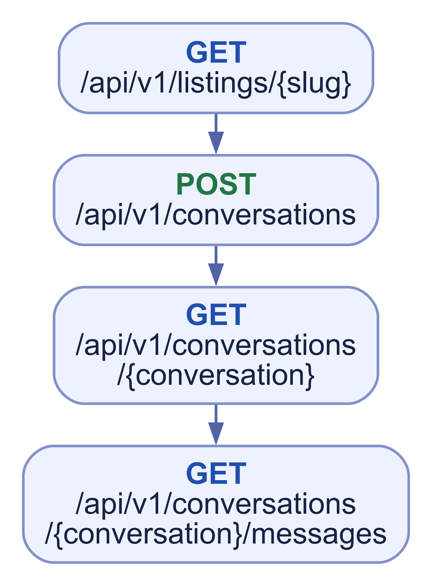
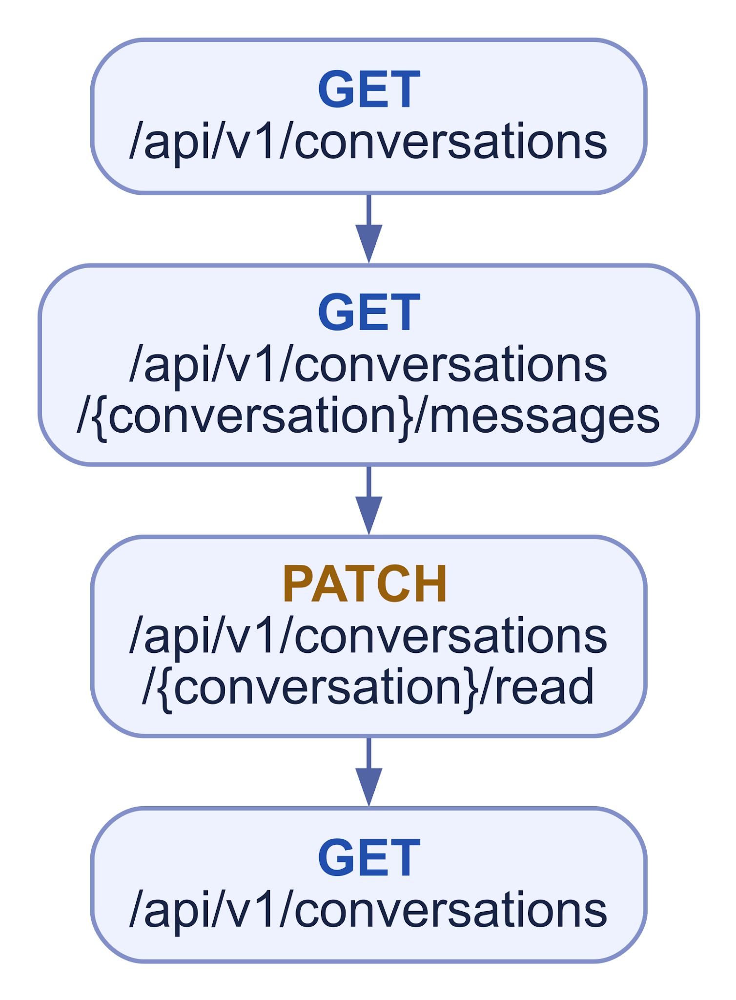
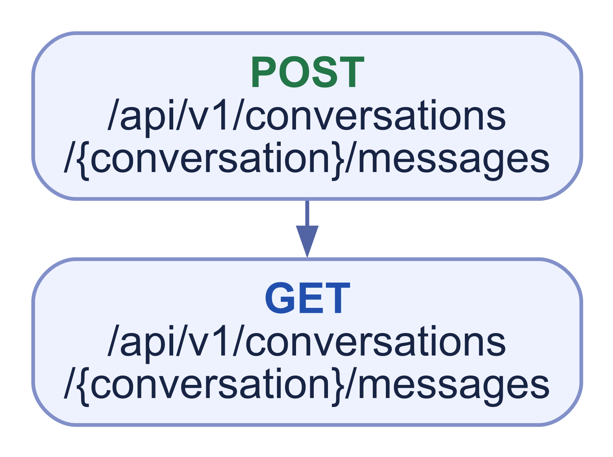
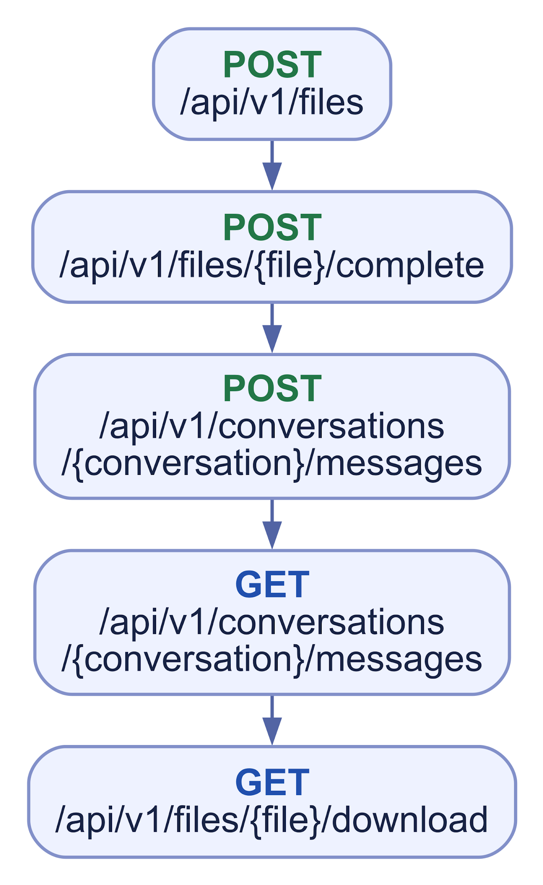
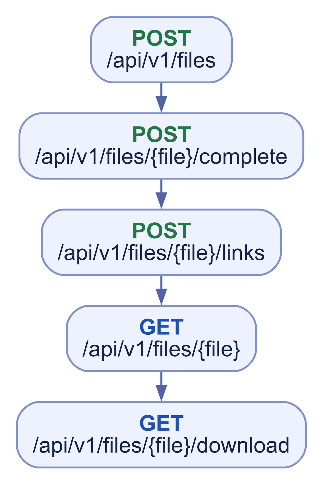
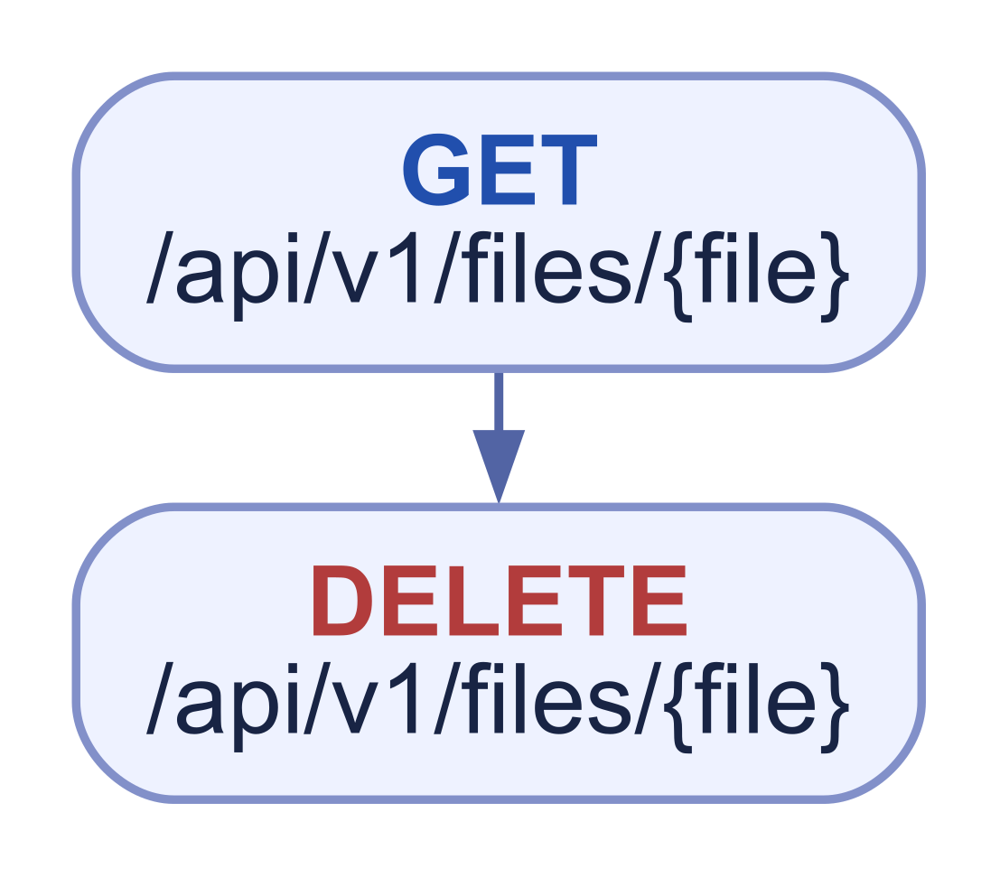
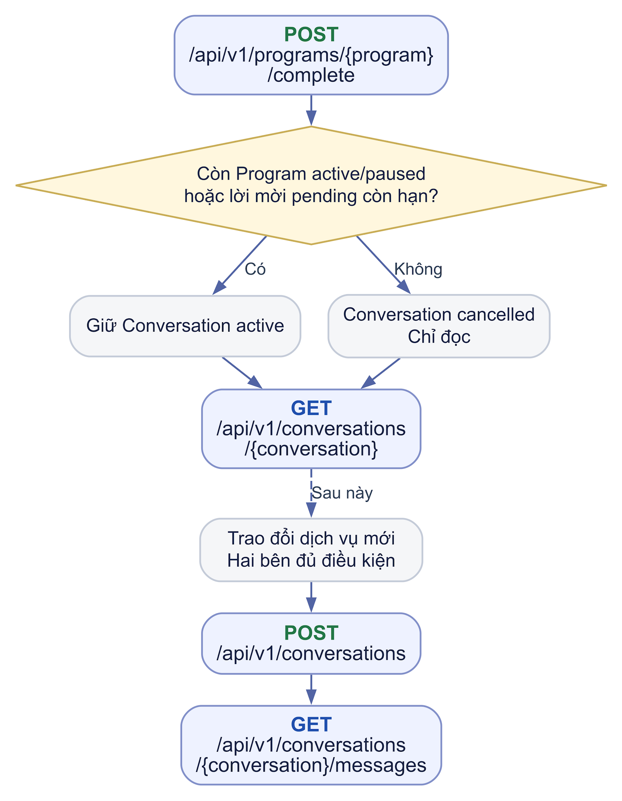

# WF03 Chat và tệp đính kèm

## 01 Mở hội thoại đúng cặp

****

Find-or-create theo Customer–Tutor; cùng cặp luôn tái dùng Conversation. BR-17: request nhận `peer_user_id` và `context_listing_id` tùy chọn; server kiểm Listing đầu vào nhưng chỉ lưu context khi tạo chat lần đầu, không ghi đè khi mở từ Listing khác. Response trả peer tối thiểu và context gốc; UI cho biết đây là chat đã có. Các sơ đồ nhúng chưa thể hiện đầy đủ DTO/quy tắc này.

## 02 Danh sách và polling

****

Inbox theo message mới nhất `(created_at,id)` giảm dần; unread đếm message của peer sau read cursor, không tính system message; read receipt chỉ ở mức Conversation. Member active đọc lịch sử khi peer bị đình chỉ hoặc chat cancelled nhưng không gửi khi peer bị đình chỉ. Member bị đình chỉ bị từ chối truy cập kể cả khi còn session cũ; sau khôi phục đọc lại theo membership. Admin không có inbox chat, chỉ xem evidence đúng Report theo BR-11.

## 03 Gửi tin văn bản

****

Body không trắng, tối đa 4.000 ký tự; chuẩn hóa CRLF/CR thành LF. Cùng client\_message\_id và payload canonical trả message cũ; cùng key khác payload trả 409. Tối đa 30 message mới/phút/người dùng; vượt hạn trả 429 và Retry-After. System chỉ backend tạo.

## 04 Chat chỉ text — điều chỉnh 29/10/2026

****

Theo [K03.1](../handover/BE-K03-K03.1-contract.md), không upload/gửi/gắn file trong Conversation; FE không hiển thị đính kèm. Không tạo Message/FileLink từ request attachment. Sơ đồ image4 là luồng cũ, không phải hành vi đích. Dữ liệu legacy nếu có cần bảo toàn và đối soát, không xóa enum/schema hàng loạt. [K03.8](../handover/BE-K03-K03.8-test-report.md) đã kiểm tra kỹ thuật các đường chặn và bảo toàn fixture legacy; không bổ sung quyền download chat. UI chat chưa có để nghiệm thu E2E.

## 05 Gắn tệp vào tài nguyên hiện có

****

Chỉ dùng resource\_type/purpose trong catalog và resource đã tồn tại, đúng quyền. Tạo tài nguyên mới nên gắn file nguyên tử tại API của tài nguyên.

Không cho link resource message. File Task/Submission qua module tương ứng, không chờ duyệt nội dung; CV có duyệt theo phiên bản riêng. Complete chỉ kiểm tra kỹ thuật, không antivirus; pending/rejected không được sử dụng. K03.7b đã đồng bộ frontend/upload/complete cho mọi upload mới tối đa 5.000.000 byte; kiểm byte boundary và file rỗng đã có evidence. Quyền resource/retention/cleanup không tự có chỉ vì complete thành công.

## 06 Xóa tệp chưa dùng

****

Chỉ owner; tệp còn liên kết hoặc lịch sử cần giữ bị từ chối. Pending orphan dọn sau 24 giờ; complete chưa link dọn sau 7 ngày; storage cleanup retry/compensation an toàn.

## 07 Đóng và mở lại hội thoại

****

Complete chỉ đóng khi không còn Program active/paused và Invitation pending còn hạn. Bước POST sau chỉ khi bắt đầu dịch vụ mới, đủ điều kiện; không tạo cặp trùng hoặc ghi đè context. Lifecycle không tự chèn system message. Đình chỉ participant không tự đóng chat hay xóa membership/lịch sử. Không có API đóng chat thủ công.

## Realtime theo phiên — bổ sung 30/10/2026

Sau đăng nhập, member gọi POST /api/v1/conversations/{conversation}/realtime bằng session và CSRF để lấy channel/expiry, rồi ký POST /broadcasting/auth bằng đúng session và socket_id. Channel là private-conversations.{id}.sessions.{token}; channel chung cũ bị từ chối. Worker sau commit chỉ phát tới những session/registry còn quyền, dùng cùng khóa User với logout/suspend. Logout thu hồi một phiên; suspend account/Profile thu hồi mọi phiên; restore không hồi sinh token. Reconnect lấy channel còn hợp lệ, auth socket mới rồi gọi REST after từ checkpoint, drain has_more và dedupe server message ID. Reverb/worker outage không thay thế hoặc làm mất dữ liệu REST. [K03.13 evidence](../handover/BE-K03-K03.13-test-report.md) kiểm consumer probe; K03.12 UI/Echo hoãn, chưa chứng nhận listener/poll cleanup hoặc hành vi UI.
