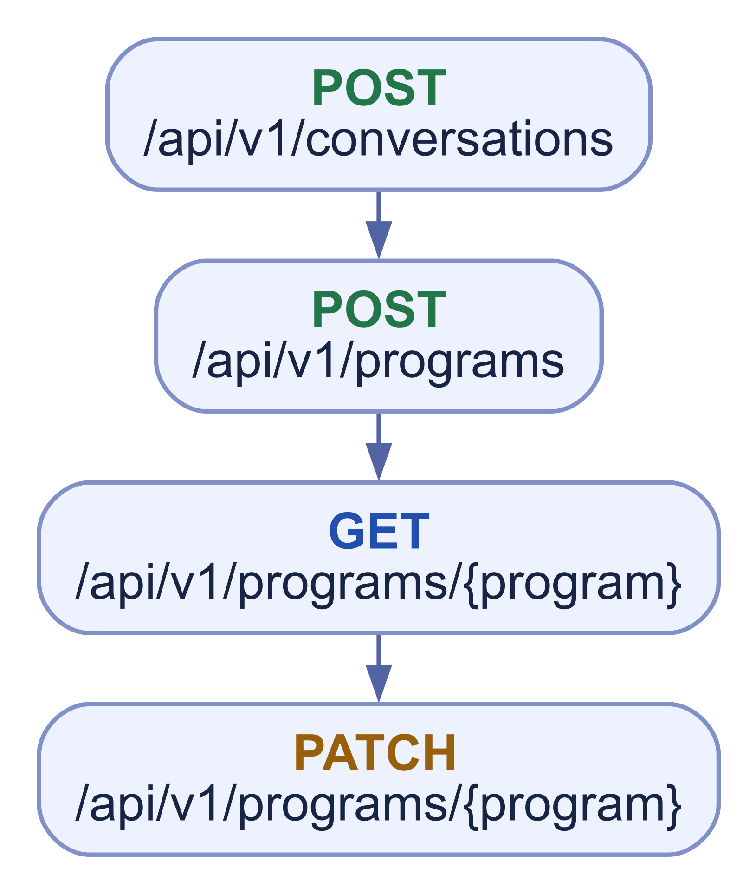
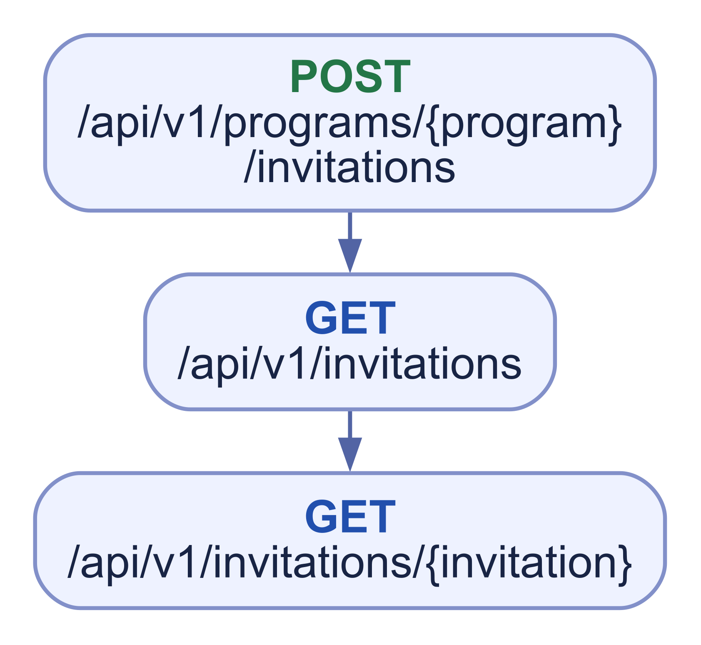
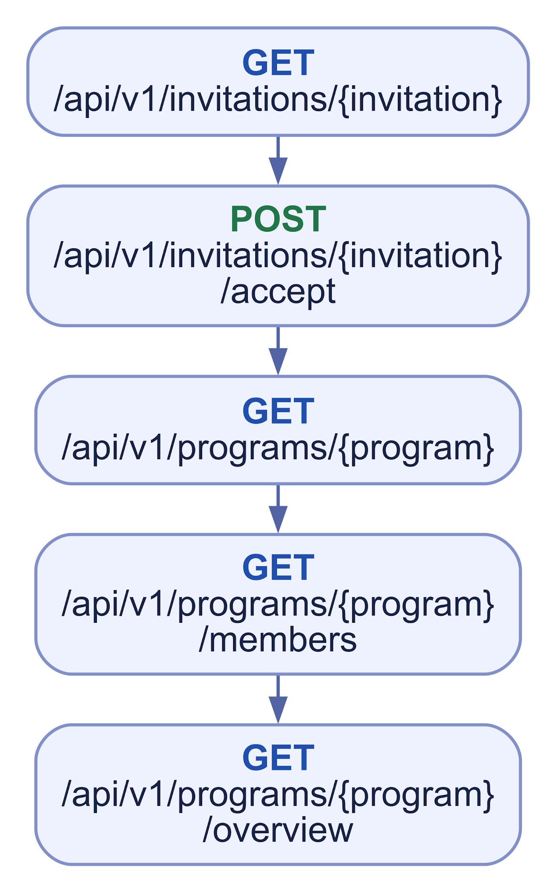
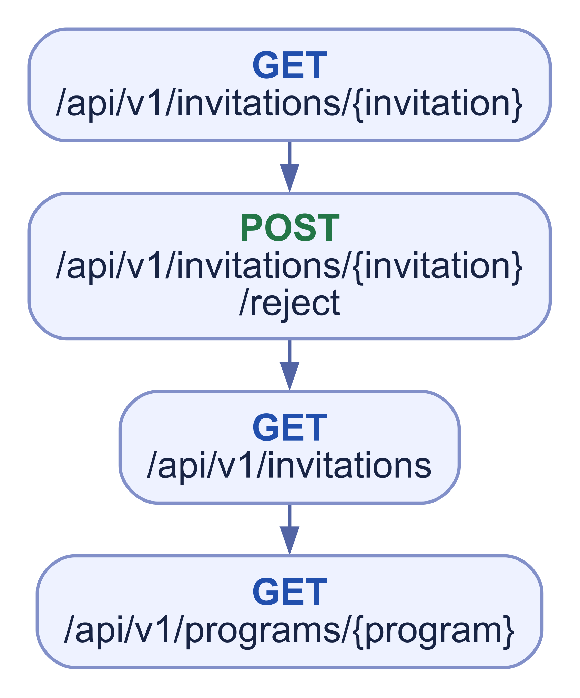
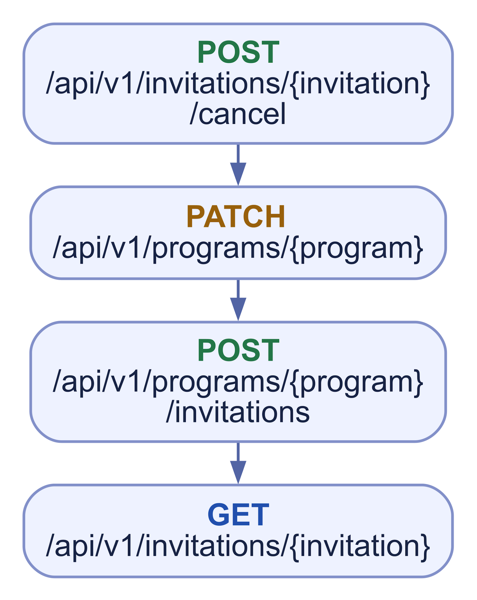
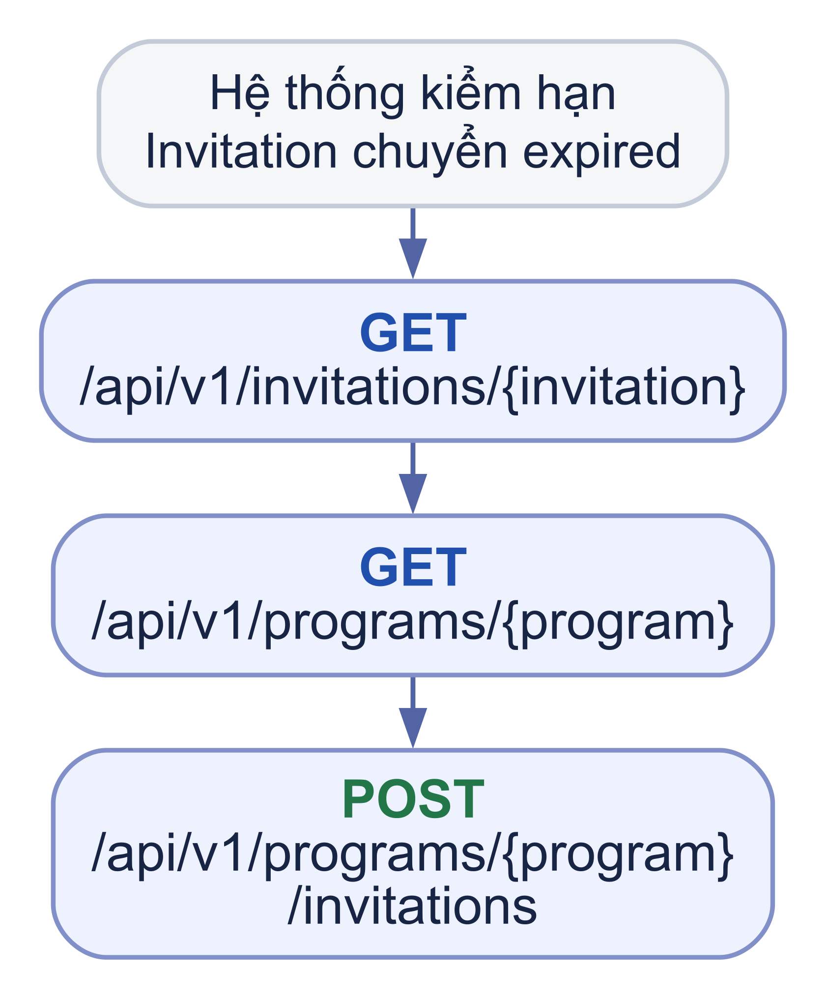
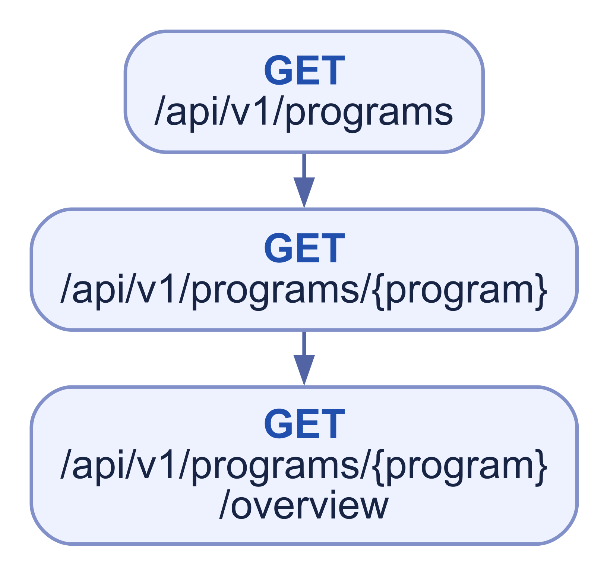
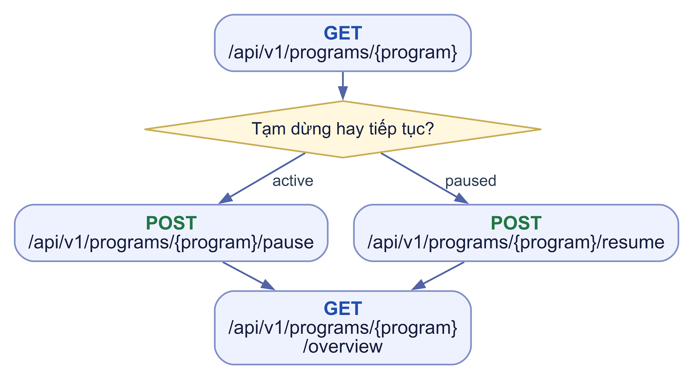
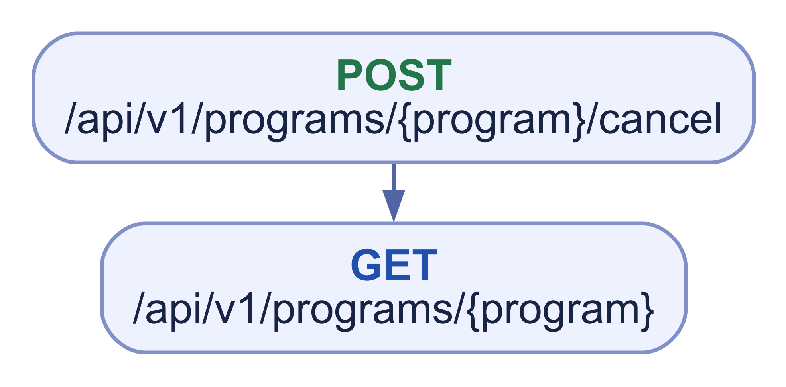

# WF04 Program và Invitation

## 01 Tạo Draft thỏa thuận

****

Customer đích được lấy từ cặp trao đổi; Tutor approved tạo Draft. Chat là ngữ cảnh, không điều kiện tạo member.

## 02 Gửi lời mời

****

Khóa snapshot, một pending còn hiệu lực; hạn 72 giờ.

## 03 Customer chấp nhận

****

Customer đích là actor accept; server đồng thời kiểm Tutor liên quan đủ điều kiện. accepted \+ membership \+ active trong một transaction.

## 04 Customer từ chối

****

Program còn draft để Tutor sửa/gửi mới; Customer không tự được cấp quyền GET Program Draft, bước cuối dành Tutor owner.

## 05 Tutor thu hồi để sửa offer

****

Tạo Invitation mới với snapshot/hạn mới; không sửa Invitation cũ.

## 06 Lời mời hết hạn

****

Hệ thống/scheduler đánh expired, không có expire API public. Customer đọc Invitation; Tutor owner đọc Draft và gửi lời mời mới.

## 07 Đọc danh sách Program

****

Server lọc theo owner/member; Invitation detail là điểm xem offer của Customer trước accept.

## 08 Tạm dừng và tiếp tục

****

## 09 Hủy Program

****

Tutor owner, có reason; terminal chỉ đọc, không Review.
