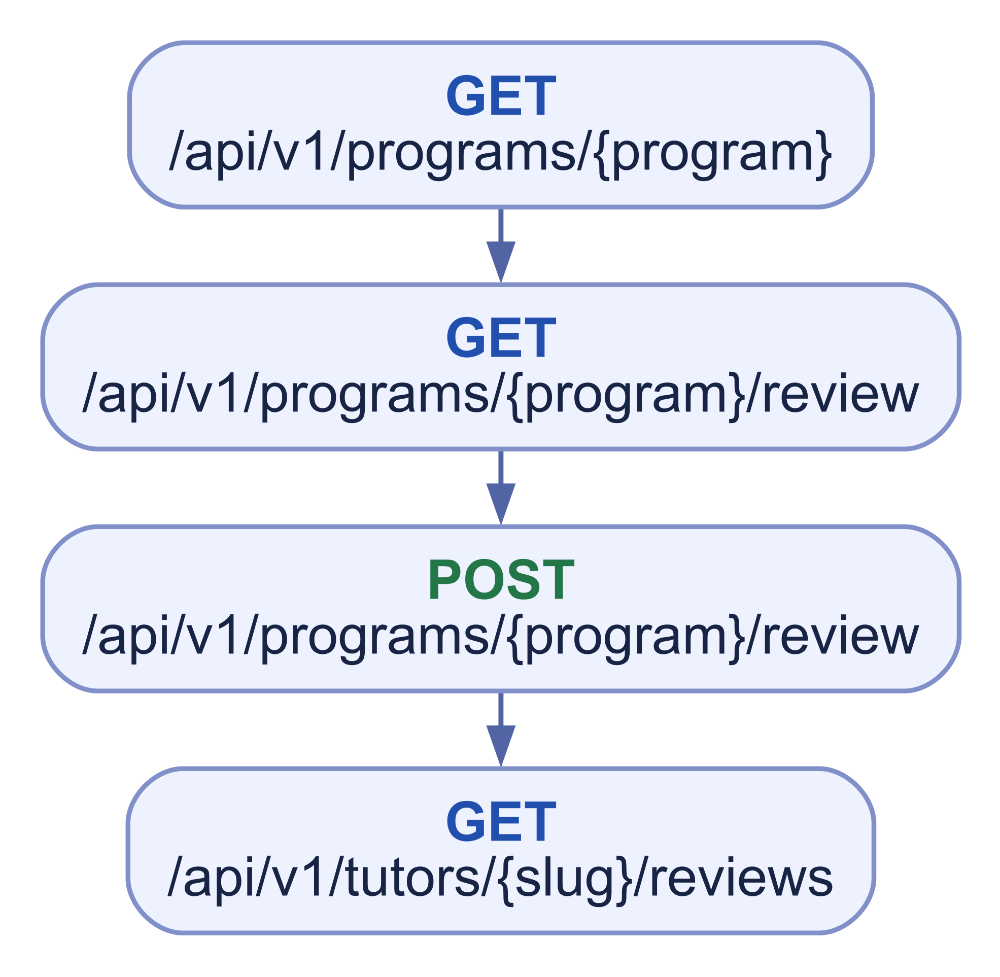
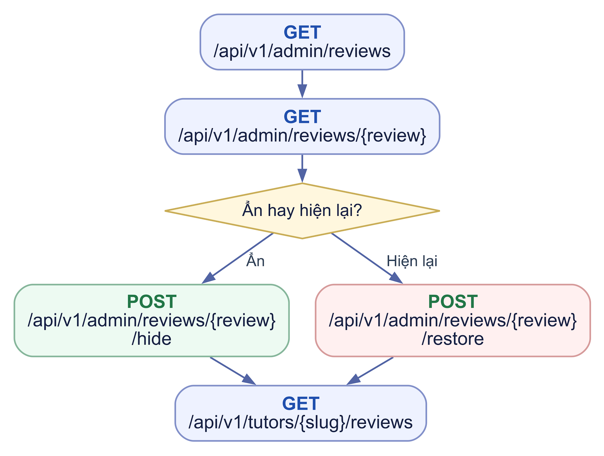
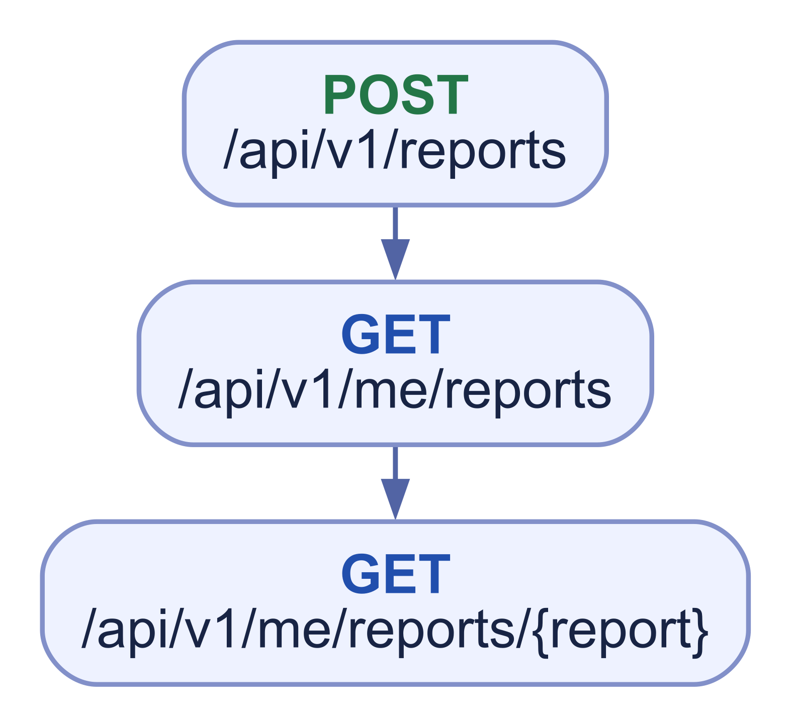
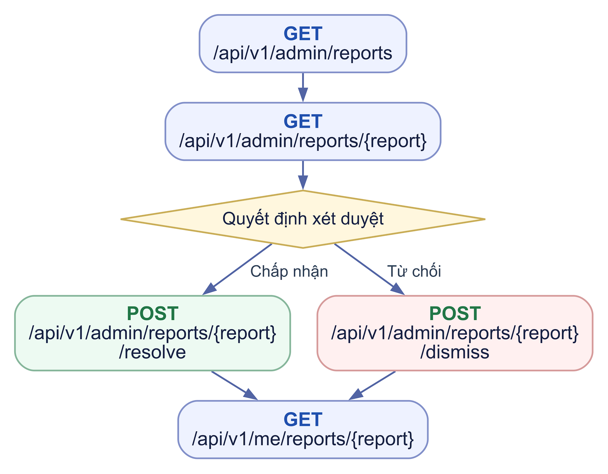
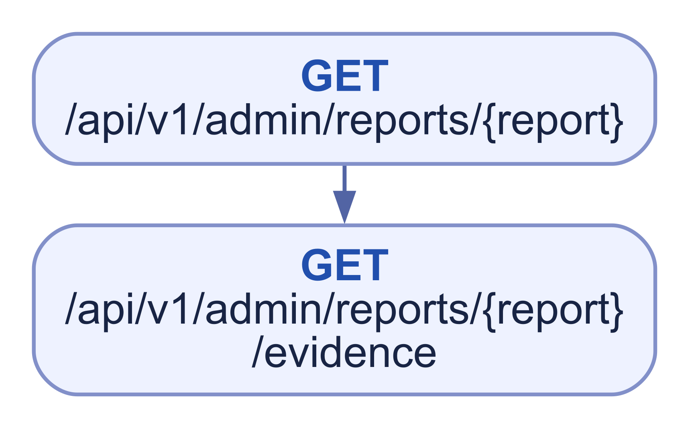
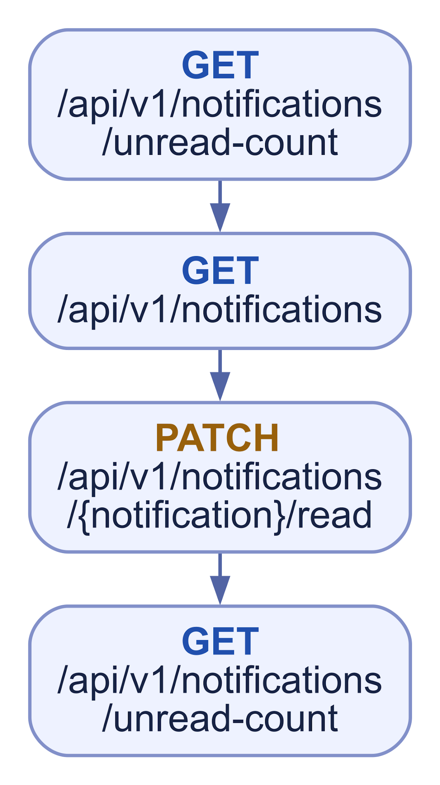
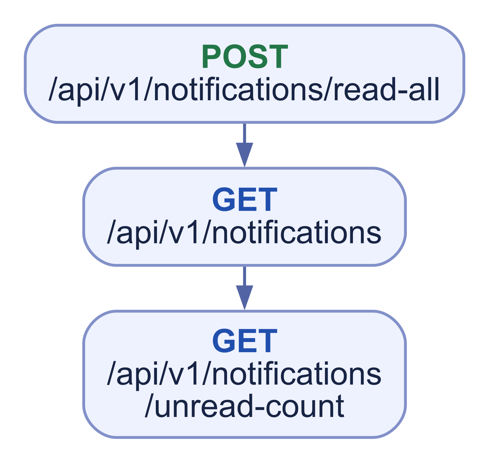
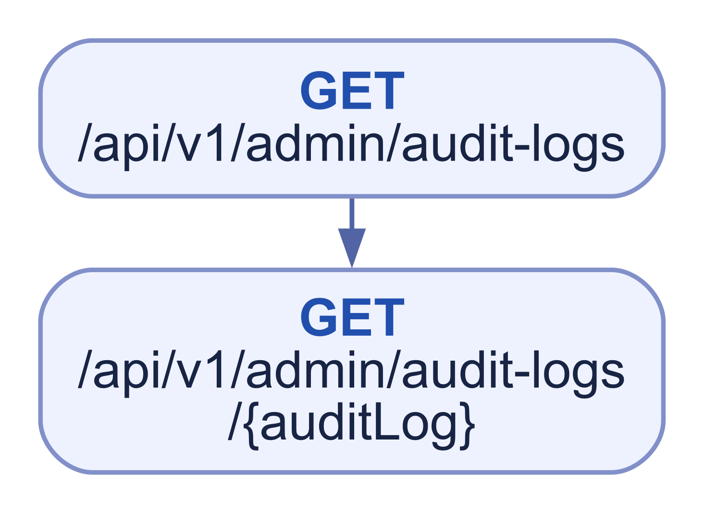

# WF06 Review Report Notification và Audit

## 01 Customer đánh giá sau hoàn thành

****

Một Review mỗi Customer/Program completed; không sau cancelled. Public chỉ visible hợp lệ.

## 02 Admin ẩn hoặc hiện lại Review

****

Nhánh khôi phục dùng POST /api/v1/admin/reviews/{review}/restore. Admin không sửa sao/nội dung.

## 03 Gửi và theo dõi Report

****

Chỉ resource allow-list người gửi được xem; other cần description.

## 04 Admin giải quyết Report

****

Nhánh bác bỏ dùng POST /api/v1/admin/reports/{report}/dismiss; resolution\_note bắt buộc.

## 05 Đọc evidence theo vụ việc

****

Theo BR-11, chỉ Admin active có `admin.reports.view`, assignment hiện tại và Report `open` mới đọc evidence, mọi truy cập có audit. Với Report về message, chỉ trả message bị báo cáo cùng tối đa 10 tin trước/5 tin sau trong cùng Conversation. Đóng Report hoặc chuyển/thu hồi assignment chặn evidence từ request tiếp theo. Không cấp quyền gửi chat, tham gia Workspace hoặc tải giấy tờ toàn cục cho Admin; file evidence còn qua policy M10.

## 06 Notification và điều hướng

****

Mở deep\_link nội bộ tới API resource tương ứng; resource vẫn kiểm quyền. Trong transaction với mutation, backend ghi notification\_outbox theo ma trận recipient/type; worker Docker đọc outbox đã commit, tạo notification idempotent theo (user\_id,type,event\_key), rồi đánh dấu processed cùng transaction. Dùng queue/database trong PostgreSQL; Redis chưa cần cho luồng này. Không có POST notification public.

## 07 Đọc toàn bộ notification

****

## 08 Đọc Audit

****

Chỉ Admin audit viewer trong scope; không API sửa/xóa log.

F03 — Bước phân công Report  
Report mới có thể chưa phân công. Coordinator có admin.reports.assign giao cho Admin nội bộ active có quyền xử lý; hệ thống ghi before/after, actor, reason, version và audit. Queue assignment chỉ lộ metadata tối thiểu. Xem detail/evidence cần admin.reports.view và assignment hiện tại; evidence còn yêu cầu Report open theo BR-11, resolve/dismiss cần admin.reports.decide. Reassignment thu hồi scope cũ. Sơ đồ nhúng cần phản ánh bước này; retention dữ liệu vẫn cần chốt riêng.
