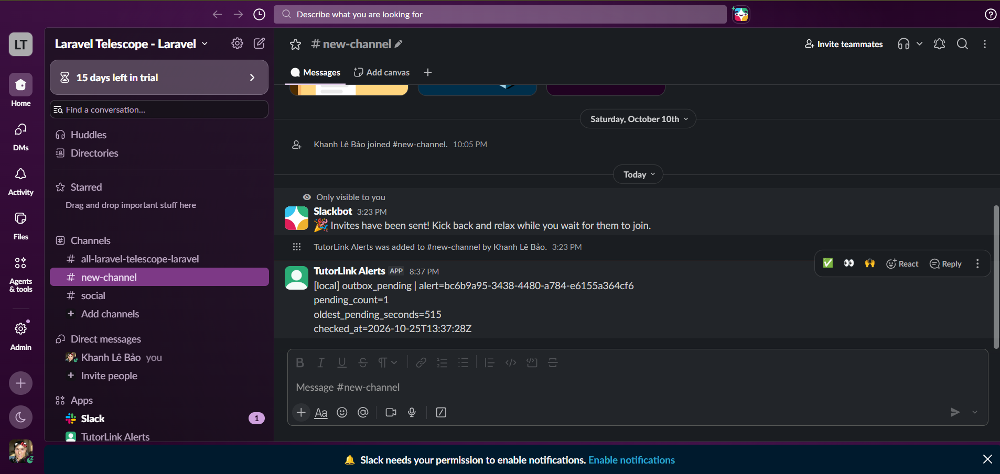

# BE-K02 / K02.8 — Demo Slack thật

Ngày demo: 25/10/2026, môi trường local Docker. Người dùng thực hiện mutation, dừng/bật worker và gửi cảnh báo thật; lượt hoàn thiện bàn giao chỉ đọc lại DB/log, không gửi thêm tin.

## Luồng đã thực hiện

1. Dừng outbox-worker, slack-worker và scheduler; Request Changes một Tutor Profile demo qua ứng dụng.
2. Xác nhận outbox đã commit nhưng processed_at null và chưa có notification.
3. Khi pending hơn 5 phút, chạy `outbox:monitor` bằng service scheduler. Kết quả: `Queued 1 operational alert(s).`; bảng jobs có job ID 1 trên queue slack, attempts 0.
4. Bật slack-worker; Slack nhận cảnh báo outbox_pending. Alert ID trên ảnh khớp log sent, attempt 1.
5. Bật lại cả ba tiến trình; outbox được xử lý, failed_at null và chỉ có một notification cùng recipient/type/event_key.

## Đối chiếu bằng chứng

| Trường | Giá trị |
| --- | --- |
| Channel | `#new-channel`, ID `C0C8BM660TB` |
| Bot | TutorLink Alerts |
| Outbox ID | `67e77d46-3367-4f3f-baeb-2530d6153fec` |
| Recipient / resource | user_id 62 / Tutor Profile 27 |
| Type | `tutor_profile_changes_requested` |
| Event key | `profile:27:changes-requested:18` |
| Outbox created_at | `2026-10-25 13:28:54+00` (20:28:54 UTC+07) |
| Notification trước bật worker | 0, theo transcript người dùng |
| Job ID | 1, theo truy vấn jobs người dùng trước bật slack-worker |
| Alert ID | `bc6b9a95-3438-4480-a784-e6155a364cf6` |
| Monitor checked_at | `2026-10-25T13:37:28Z` |
| Nội dung tổng hợp | pending_count=1; oldest_pending_seconds=515 |
| Slack gửi thành công | `2026-10-25T13:37:56.744431Z` (20:37:56 UTC+07); slack_sent, attempt 1 |
| Outbox processed_at | `2026-10-25 13:41:53.639865+00` (20:41:53 UTC+07) |
| failed_at / notification count sau xử lý | null / **1** |
| Kiểm tra lại chỉ đọc | `2026-10-25T13:47:14+00:00`; kết quả không đổi |

Ảnh là evidence Slack thật; chưa có permalink tin nhắn được cung cấp. Không dựng link tin nhắn từ alert_id. Cảnh báo pending được gộp, không chứa outbox ID từng row; liên kết với event demo dựa trên backlog một row, transcript và thời điểm monitor.

## File evidence

- [Ảnh gốc do người dùng lưu](evidence/be-k02-k02.8/slack-demo.png)
- [Tóm tắt transcript trước/sau xử lý](evidence/be-k02-k02.8/demo-event.txt)
- [Log ứng dụng đúng alert ID](evidence/be-k02-k02.8/slack-sent.txt)
- [Log slack-worker](evidence/be-k02-k02.8/slack-worker.txt)
- [Trạng thái ba container sau demo](evidence/be-k02-k02.8/containers.txt)
- [Scheduler sau khi bật lại](evidence/be-k02-k02.8/scheduler.txt)
- [DB/config được xác minh lại, không chứa token](evidence/be-k02-k02.8/runtime-state.json)
- [Script kiểm chỉ đọc](evidence/be-k02-k02.8/runtime-check.php)

## Phạm vi xác nhận

Demo xác nhận một outbox đã commit tồn tại khi worker dừng, monitor enqueue cảnh báo, Slack API thực nhận tin và worker sau đó tạo một in-app notification. Không gửi event nghiệp vụ trực tiếp vào Slack. Các nhánh lỗi Slack và SIGKILL trước commit được kiểm riêng trong [K02.7](BE-K02-K02.7-test-report.md). Demo này không chứng minh exactly-once, không mô phỏng mất cả máy và không thực hiện purge dữ liệu thật.
