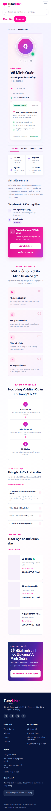
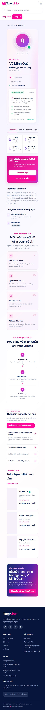
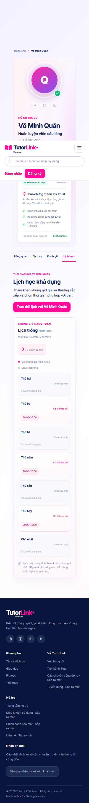
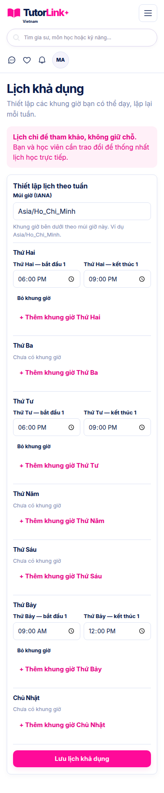
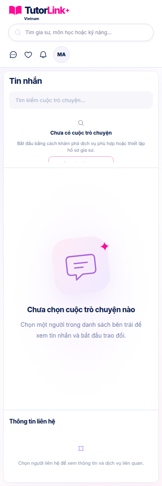
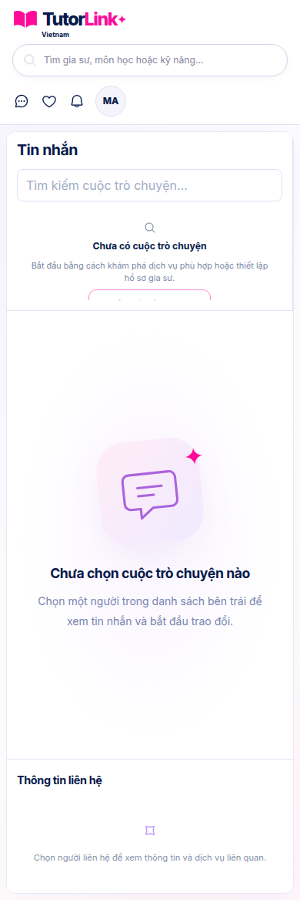
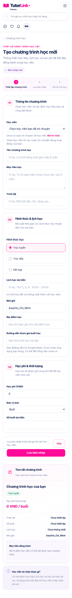
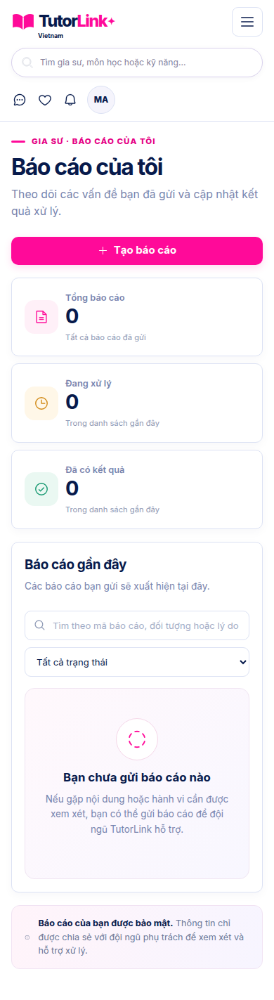

# Handover Evidence — Tiêu chí 3(a): Next.js, component dùng lại và Tailwind CSS

Tài liệu này đối chiếu giao diện TutorLink trước và sau đợt chuyển cấu trúc/responsive chính sang Tailwind utility classes. Ảnh đều được chụp trực tiếp từ ứng dụng bằng Playwright và Google Chrome, không dùng mockup hoặc ảnh AI.

## Ảnh Before / After

Before được chạy từ worktree sạch tại commit `0b8bbb0` (trước refactor). After được chụp từ production build sạch hiện tại. Hai lượt dùng cùng backend local demo, cùng tài khoản tutor demo cho trang được bảo vệ, locale mặc định, cùng đường dẫn, cùng kích thước trình duyệt và cùng bước đợi dữ liệu bất đồng bộ ổn định. Mỗi lượt có 42 ảnh full-page: 14 trạng thái màn hình nhân 3 viewport.

| Màn hình | Mobile · 390px | Tablet · 768px | Desktop · 1440px |
| --- | --- | --- | --- |
| Trang chủ | [Before](Before/home-mobile.png) · [After](After/home-mobile.png) | [Before](Before/home-tablet.png) · [After](After/home-tablet.png) | [Before](Before/home-desktop.png) · [After](After/home-desktop.png) |
| Marketplace | [Before](Before/marketplace-mobile.png) · [After](After/marketplace-mobile.png) | [Before](Before/marketplace-tablet.png) · [After](After/marketplace-tablet.png) | [Before](Before/marketplace-desktop.png) · [After](After/marketplace-desktop.png) |
| Hồ sơ tutor | [Before](Before/tutor-profile-mobile.png) · [After](After/tutor-profile-mobile.png) | [Before](Before/tutor-profile-tablet.png) · [After](After/tutor-profile-tablet.png) | [Before](Before/tutor-profile-desktop.png) · [After](After/tutor-profile-desktop.png) |
| Lịch trên hồ sơ tutor | [Before](Before/tutor-schedule-mobile.png) · [After](After/tutor-schedule-mobile.png) | [Before](Before/tutor-schedule-tablet.png) · [After](After/tutor-schedule-tablet.png) | [Before](Before/tutor-schedule-desktop.png) · [After](After/tutor-schedule-desktop.png) |
| About | [Before](Before/about-mobile.png) · [After](After/about-mobile.png) | [Before](Before/about-tablet.png) · [After](After/about-tablet.png) | [Before](Before/about-desktop.png) · [After](After/about-desktop.png) |
| Hỗ trợ | [Before](Before/support-mobile.png) · [After](After/support-mobile.png) | [Before](Before/support-tablet.png) · [After](After/support-tablet.png) | [Before](Before/support-desktop.png) · [After](After/support-desktop.png) |
| Trở thành tutor | [Before](Before/become-a-tutor-mobile.png) · [After](After/become-a-tutor-mobile.png) | [Before](Before/become-a-tutor-tablet.png) · [After](After/become-a-tutor-tablet.png) | [Before](Before/become-a-tutor-desktop.png) · [After](After/become-a-tutor-desktop.png) |
| Đăng nhập | [Before](Before/login-mobile.png) · [After](After/login-mobile.png) | [Before](Before/login-tablet.png) · [After](After/login-tablet.png) | [Before](Before/login-desktop.png) · [After](After/login-desktop.png) |
| Hồ sơ Tutor / onboarding | [Before](Before/tutor-onboarding-mobile.png) · [After](After/tutor-onboarding-mobile.png) | [Before](Before/tutor-onboarding-tablet.png) · [After](After/tutor-onboarding-tablet.png) | [Before](Before/tutor-onboarding-desktop.png) · [After](After/tutor-onboarding-desktop.png) |
| Lịch khả dụng | [Before](Before/availability-mobile.png) · [After](After/availability-mobile.png) | [Before](Before/availability-tablet.png) · [After](After/availability-tablet.png) | [Before](Before/availability-desktop.png) · [After](After/availability-desktop.png) |
| Hộp thư | [Before](Before/messages-mobile.png) · [After](After/messages-mobile.png) | [Before](Before/messages-tablet.png) · [After](After/messages-tablet.png) | [Before](Before/messages-desktop.png) · [After](After/messages-desktop.png) |
| Dịch vụ của tôi | [Before](Before/owner-listings-mobile.png) · [After](After/owner-listings-mobile.png) | [Before](Before/owner-listings-tablet.png) · [After](After/owner-listings-tablet.png) | [Before](Before/owner-listings-desktop.png) · [After](After/owner-listings-desktop.png) |
| Tạo Program | [Before](Before/program-builder-mobile.png) · [After](After/program-builder-mobile.png) | [Before](Before/program-builder-tablet.png) · [After](After/program-builder-tablet.png) | [Before](Before/program-builder-desktop.png) · [After](After/program-builder-desktop.png) |
| Báo cáo | [Before](Before/reports-mobile.png) · [After](After/reports-mobile.png) | [Before](Before/reports-tablet.png) · [After](After/reports-tablet.png) | [Before](Before/reports-desktop.png) · [After](After/reports-desktop.png) |

Ví dụ đối chiếu ảnh thực tế trên mobile:

| Before | After |
| --- | --- |
|  |  |
|  |  |
|  |  |
|  |  |
|  |  |
|  |  |
|  |  |
|  |  |

Ảnh hồ sơ tutor mobile có chiều cao full-page gần tương đương: Before 6,038 CSS px, After 6,055 CSS px. Nội dung, thứ tự section, màu sắc và dữ liệu demo được giữ. Marketplace mobile cùng có 6 dịch vụ và trạng thái tải hoàn tất; script chờ kết quả tìm kiếm trước khi chụp.

## Thay đổi kỹ thuật

- Cấu hình Tailwind CSS 4 trong `/frontend/src/app/globals.css`, giữ token màu/font hiện tại và breakpoint responsive tương ứng layout gốc: `sm` 700px, `md` 900px, `lg` 1180px.
- Các stylesheet trình bày còn giữ được nạp trong cascade layer `components`; Tailwind utilities ở layer sau có thể điều khiển layout/breakpoint đã chuyển đổi thay vì bị CSS cũ ghi đè. CSS riêng vẫn giữ cho chi tiết tạo hình, pseudo-element, animation, trạng thái và widget phức tạp.
- Chuyển cấu trúc và breakpoint của shared header/footer, shared UI (`Button`, `Input`, `Select`, `Field`, `Card`, `Badge`), trang public, auth, marketplace/tutor profile, account/settings, availability, reports, messaging, notifications, program/workspace và một số dashboard/admin sang utility classes.
- Dùng mobile-first: ví dụ `grid-cols-1 sm:grid-cols-2 lg:grid-cols-3`, `flex-col sm:flex-row`, `overflow-x-auto` cho dải tab/filter trên mobile.
- Xóa CSS riêng của About, Support và auth layout sau khi chuyển phần trình bày tương ứng sang utility/shared component.
- Không chuyển máy móc animation, pseudo-element, shimmer/skeleton, trạng thái chuyên biệt, lịch calendar, bảng có nhiều cột, trust badge, modal hoặc quy tắc nội dung dài. Các stylesheet chuyên biệt còn lại phục vụ những hiệu ứng/trạng thái đó; những chỉnh sửa responsive cấu trúc được đưa vào class utility ở component gần nhất.
- React tiếp tục render nội dung người dùng dưới dạng text mặc định. Test xác nhận bio có chuỗi HTML không tạo phần tử `` thật: `/frontend/src/tests/marketplace/marketplace-journeys.test.tsx`.

Một sai lệch mobile đã có từ baseline: hero “Trở thành tutor” dùng lưới hai cột quá hẹp. Utility mobile-first hiện xếp hero thành một cột; đây là sửa lỗi tràn/bố cục mobile, không đổi nội dung hay phong cách thiết kế.

## Bằng chứng tiêu chí 3(a)

| Tiêu chí | Bằng chứng trong dự án |
| --- | --- |
| Next.js | App Router tại `/frontend/src/app/`, route public/auth/workspace dùng component React. |
| Component dùng lại | `/frontend/src/components/shared/ui.tsx` cung cấp Button, Field, Input, Select, Card, Badge và StatePanel; AppShell/shared navigation được dùng chung giữa các route. |
| Tailwind utility classes | Ví dụ trong `marketplace-search.tsx`: `grid grid-cols-1 ... md:grid-cols-[220px_minmax(0,1fr)]`; `public-tutor.tsx`: `grid-cols-1 sm:grid-cols-[...] lg:grid-cols-[...]`; `messaging.tsx`: grid hộp thư đổi từ một sang hai/ba cột; `availability-editor.tsx`: các cột khung giờ đổi theo `sm`/`md`; `app-shell.tsx` và `ui.tsx` dùng utility cho shell, controls và field. |
| Escape HTML | React text interpolation và test bio chống HTML thô ở `marketplace-journeys.test.tsx`; không dùng `dangerouslySetInnerHTML` cho nội dung người dùng. |
| Không đổi backend/API/quyền | Diff chỉ gồm frontend, test frontend và bằng chứng; submit handler, payload API, route, phân quyền và xác thực không đổi. |

## Kiểm thử và Playwright

Các lệnh frontend đã chạy sau từng nhóm chuyển đổi:

```bash
npm run lint -- --quiet
npm run typecheck
npm test -- --reporter=dot
npm run build
TAILWIND_EVIDENCE_URL=http://localhost:3000 node scripts/tailwind-evidence.mjs After
```

Khi chụp production server local ở cổng khác allowlist CORS của backend, dùng `TAILWIND_DISABLE_WEB_SECURITY=true` để trình duyệt kiểm thử truy cập API demo local (chỉ dùng trong browser automation cục bộ):

```bash
TAILWIND_DISABLE_WEB_SECURITY=true TAILWIND_EVIDENCE_URL=http://localhost:3010 node scripts/tailwind-evidence.mjs After
```

Kết quả lượt kiểm thử cuối:

- ESLint: pass.
- TypeScript typecheck: pass.
- Vitest: 40 test files, 210 tests pass.
- Coverage sau migration: statements **80.57%** (3,405/4,226), lines **85.70%** (2,937/3,427); cả hai vượt gate **80.01%**.
- Production build: pass; Next.js sinh 37 trang tĩnh và các route dynamic, bảng route/build không phát sinh lỗi.
- Playwright production: 42/42 ảnh After nhận HTTP 200; 0 viewport tràn ngang; 0 lỗi tải dữ liệu hiển thị; 0 lỗi `pageerror`. Bộ Before ở commit gốc cũng đạt cùng kiểm tra 42/42. Các trang tutor/workspace và báo cáo dùng cùng tutor demo đã đăng nhập.
- Viewport: 390 × 1000, 768 × 1000 và 1440 × 1000; full-page screenshot; device scale factor 1; giảm animation; đợi font và marketplace data.

Chạy lại script từ `frontend/`. Script hỗ trợ `TAILWIND_EVIDENCE_URL`, `TAILWIND_AUTH_EVIDENCE_URL`, `TAILWIND_EVIDENCE_OUTPUT`, `TUTORLINK_CHROME_PATH`, `TAILWIND_API_ORIGIN`, `TAILWIND_DEMO_EMAIL` và `TAILWIND_DEMO_PASSWORD`. Khi chụp workspace, truyền thông tin tutor demo qua hai biến `TAILWIND_DEMO_*`; script đăng nhập bằng giao diện và chụp onboarding cùng lịch khả dụng trong cùng phiên. Nó xác nhận HTTP status, overflow, lỗi JavaScript và thông báo lỗi tải dữ liệu trước khi tính lượt chụp là pass. `TAILWIND_DISABLE_WEB_SECURITY=true` chỉ dùng khi kiểm thử qua origin local không có trong allowlist CORS; không dùng cho ứng dụng.

## Giới hạn phạm vi bằng chứng

Ảnh Before/After bao phủ màn hình public/auth chính, hồ sơ tutor ở tab hồ sơ và tab lịch, cùng các màn hình workspace tutor đã liệt kê. Một số workspace khác và admin chưa có cặp ảnh baseline trong bộ evidence này vì cần phiên đăng nhập theo vai trò riêng. Ảnh chứng minh các màn hình đã đối chiếu không bị redesign; chúng không thay cho kiểm thử Core Web Vitals trên môi trường production. CSS đặc thù và một số stylesheet của trang chưa nằm trong nhóm chuyển đổi vẫn còn; vì vậy bằng chứng này xác nhận phạm vi đã chuyển đổi, chưa khẳng định mọi style của toàn bộ frontend đã được thay thế bằng Tailwind.
